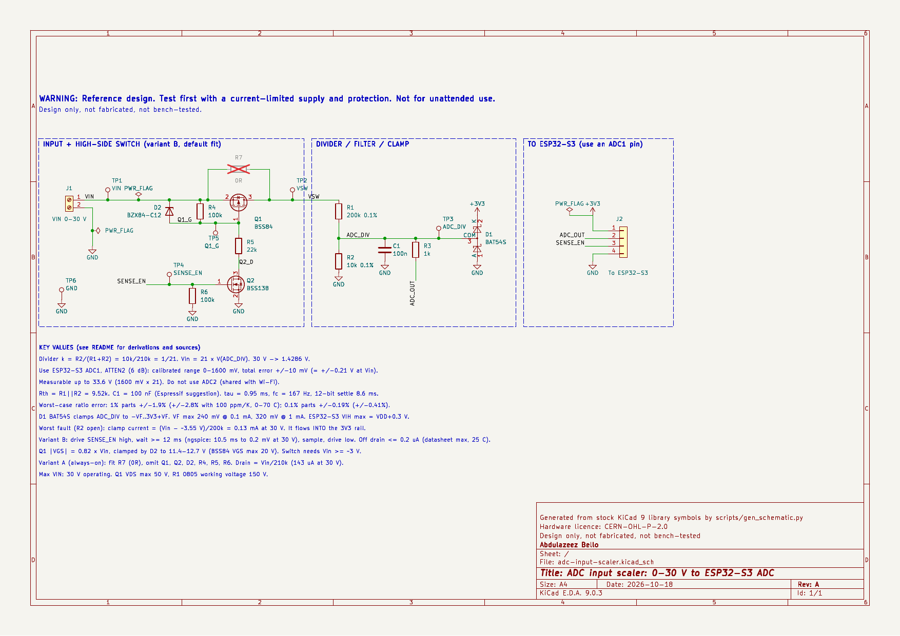
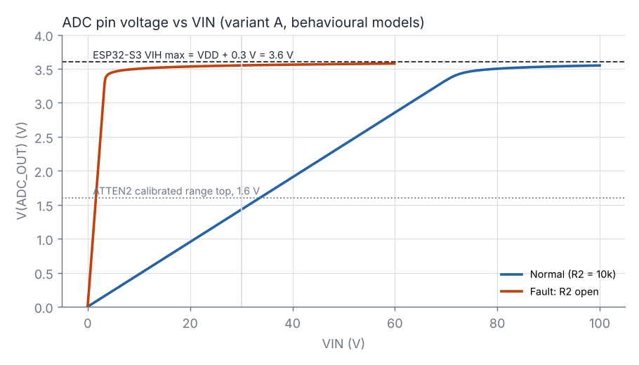
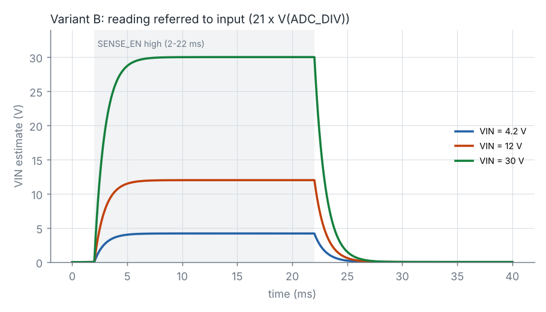
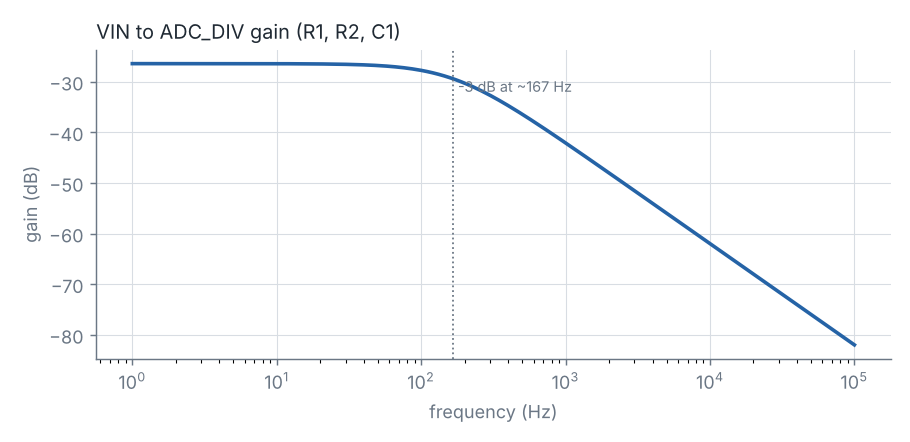

# ADC input scaler: 0–30 V to an ESP32-S3 ADC pin

Open-source KiCad reference design by **Abdulazeez Bello**, embedded systems engineer.

> **WARNING — Reference design. Test first with a current-limited supply and protection. Not for unattended use.**
> The battery-sense variant is meant to be connected to battery packs, including Li-ion. Nothing here is certified or claims compliance with any safety standard.

**Status: Design only, not fabricated, not bench-tested.**

Schematic generated with AI assistance at my direction; I reviewed pin assignments against the datasheets.



| | |
|---|---|
| Schematic (PDF) | [`docs/adc-input-scaler-schematic.pdf`](docs/adc-input-scaler-schematic.pdf) |
| KiCad project (KiCad 9) | [`hardware/`](hardware/) |
| Bill of materials | [`docs/adc-input-scaler-bom.csv`](docs/adc-input-scaler-bom.csv) |
| ERC report | [`docs/erc.rpt`](docs/erc.rpt) |
| SPICE decks and results | [`sim/`](sim/) |
| Calculator | [`scripts/divider_calc.py`](scripts/divider_calc.py) |

---

## 1. What it does

It scales a battery or bus voltage of 0–30 V down to the input range of one ESP32-S3 ADC1 channel, filters it for the ADC's sampler, and clamps the pin so that a wiring or component fault cannot drive it beyond the 3.3 V rail plus one Schottky drop.

The board comes in two assembly variants:

- **Variant B (default fit): battery sense with a high-side switch.** A P-MOSFET (Q1) connects the divider only while the ESP32 drives `SENSE_EN` high. The rest of the time the divider draws nothing, so a battery is not slowly drained by the measurement circuit.
- **Variant A: always-on divider.** Fit the 0 Ω link R7, and omit Q1, Q2, D2, R4, R5 and R6. This is simpler, and it suits a mains-fed bus, where a constant 143 µA at 30 V does not matter.

```
VIN ──[Q1 high-side switch, variant B | R7 link, variant A]── VSW
VSW ── R1 200k ──┬── ADC_DIV ──┬── R3 1k ── ADC_OUT ──> ESP32-S3 ADC1 pin
                 │             ├── C1 100n ── GND
               R2 10k          └── D1 BAT54S: clamps to GND - VF and +3V3 + VF
                 │
                GND
```

## 2. Requirements

| # | Requirement (from the brief) | How it is met | Where it is checked |
|---|---|---|---|
| R1 | Vin 0–30 V | 30 V maps to 1.4286 V. The ADC stays inside its calibrated range up to 33.6 V | §3.2, ngspice DC sweep |
| R2 | Target ADC full scale "3.3 V" | **Deviation, see §3.1.** No ESP32-S3 attenuation setting is calibrated up to 3.3 V. The design therefore uses ATTEN2 (0–1600 mV, ±10 mV), and 3.3 V becomes the protection ceiling rather than the full scale | §3.1 |
| R3 | Divider from E24/E96, with worst-case error at 1 % and 0.1 % | 200 k / 10 k (in both E24 and E96). Error table in §3.3 | `divider_calc.py` |
| R4 | Filter capacitor sized for the ADC sampling | 100 nF, as Espressif suggests. τ = 0.95 ms. Sampling-rate limits in §3.4 | calculation + ngspice AC and transient |
| R5 | A fault cannot put more than 3.3 V + a diode drop on the pin | BAT54S to +3V3 and GND, with ≥ 200 kΩ of current limiting ahead of it | §3.6, ngspice R2-open fault |
| R6 | Optional battery-sense variant with a high-side switch | Q1 BSS84 + Q2 BSS138 + D2 gate clamp | §3.7, ngspice transient |
| R7 | Nothing specific to AirChain | Generic net names and parts. No AirChain nets, parts or layout reused | — |

## 3. Design calculations

All the numbers below can be reproduced with `python3 scripts/divider_calc.py`; its full output is in [`docs/divider_calc_output.txt`](docs/divider_calc_output.txt). The source of every datasheet value is listed in §9. A value that is **not** from a datasheet is marked **[ASSUMPTION]**.

### 3.1 The ADC window (and why the full scale is not 3.3 V)

ESP32-S3 ADC calibration results (ESP32-S3-PICO-1 datasheet v1.1, Table 3-6; this SiP uses the ESP32-S3 die):

| Attenuation | Calibrated range | Total error |
|---|---|---|
| ATTEN0 (0 dB) | 0–850 mV | ±5 mV |
| ATTEN1 (2.5 dB) | 0–1100 mV | ±6 mV |
| **ATTEN2 (6 dB)** | **0–1600 mV** | **±10 mV** |
| ATTEN3 (12 dB) | 0–2900 mV | ±50 mV |

None of these settings reaches 3.3 V. ATTEN3 covers the most range, but its ±50 mV error is ±1.7 % of full scale. ATTEN2's ±10 mV is ±0.6 % of 1.6 V. **This design therefore uses ATTEN2.** Referred to the input, the ADC's own error is ±10 mV × 21 = **±0.21 V**, which is larger than the divider error when 0.1 % resistors are fitted.

The pin limit comes from the DC characteristics: V_IH max = VDD + 0.3 V = **3.6 V** at VDD = 3.3 V. The absolute maximum table gives only supply-pin limits (−0.3 to 3.6 V) and has no separate I/O row, so V_IH max is the figure the clamp is designed against.

### 3.2 Divider ratio

k = R2 / (R1 + R2) = 10 k / 210 k = **1/21 = 0.047619**, so **Vin = 21 × V_ADC**.

- 30 V → **1.4286 V**. That leaves 171 mV of headroom below the 1.6 V calibrated limit.
- The ADC reaches 1.6 V at Vin = **33.6 V**, which is the over-range margin.

Candidate search (total 150–300 kΩ, worst case at 1 %/100 ppm must stay below 1.55 V at 30 V), from the script:

| Series | Rtop | Rbot | V at 30 V | 1/k |
|---|---|---|---|---|
| E24 | 160 k | 8.2 k | 1.4625 V | 20.51 |
| E24 | **200 k** | **10 k** | **1.4286 V** | **21.00** |
| E96 | 215 k | 11.3 k | 1.4980 V | 20.03 |
| E96 | 200 k | 10.5 k | 1.4964 V | 20.05 |

The E96 pairs use about 5 % more of the ADC range. 200 k / 10 k was chosen for three reasons: it has the most worst-case headroom, the ratio is an exact integer (which makes firmware and bench checks easier), and both values sit in E24 *and* E96, so they are stocked in 0.1 % thin film.

### 3.3 Worst-case ratio error

Here tolerance and TCR are taken in opposite directions on R1 and R2, which is the worst case. TCR is applied over 0–70 °C from 25 °C (ΔT = 45 K). The 0–70 °C range is a design choice **[ASSUMPTION]**.

| Case | Ratio error | At Vin = 30 V |
|---|---|---|
| 1 % (Yageo RC, ±100 ppm/K), 25 °C | −1.89 % / +1.92 % | −0.57 / +0.58 V |
| 1 % + TCR, 0–70 °C | −2.73 % / +2.80 % | −0.82 / +0.84 V |
| **0.1 % (Yageo RT, ±25 ppm/K), 25 °C** | **−0.19 % / +0.19 %** | **−0.057 / +0.057 V** |
| 0.1 % + TCR, 0–70 °C | −0.40 % / +0.41 % | −0.12 / +0.12 V |

With 1 % parts the divider is the largest error source, and a one-point calibration in firmware is needed. With 0.1 % parts the ESP32-S3's own ±0.21 V dominates. The BOM fits 0.1 % parts, and 1 % alternates are listed in the `Alt_1pct` field.

### 3.4 Filter capacitor and sampling

- Thevenin resistance seen by C1 and the pin: R1 ∥ R2 = **9.524 kΩ**
- C1 = **100 nF**. Espressif's ADC guide suggests a 100 nF bypass capacitor on the ADC pad, and the datasheet DNL figure is specified "with an external 100 nF capacitor".
- τ = 9.524 kΩ × 100 nF = **0.952 ms**; −3 dB at **167 Hz**. ngspice gives 166.7 Hz.
- Settling to ½ LSB at 12 bits takes ln(2¹³) τ = 9.01 τ = **8.6 ms**. The variant B transient in ngspice, from `SENSE_EN` rising to within 0.2 mV of the final value, takes 8.6 ms at 4.2 V, 9.6 ms at 12 V and 10.5 ms at 30 V. **Firmware should wait ≥ 12 ms** after enabling the switch before sampling.

**Sampling capacitor — not in the datasheet.** The ESP32-S3 datasheet gives the pin capacitance (C_IN = 2 pF typ) but not the ADC's internal sampling capacitance. **[ASSUMPTION]** C_S ≤ 10 pF is assumed for the estimates below:

- Charge sharing per conversion: C_S / C1 = 10 pF / 100 nF = 10⁻⁴ of the difference between the sampler and the pin. At 1.43 V that is under 0.15 mV, less than one code.
- Average sampling current drawn through R_th: error ≈ R_th × C_S × f_s. At 1 kSPS this is 9.5 k × 10 p × 1 k ≈ **0.01 %**. At the ADC maximum of 100 kSPS it is ≈ **1 %**.

**Recommendation: one-shot reads, or bursts averaged at ≤ 1 kSPS sustained.** Any higher rate needs to be checked on the bench by comparing readings taken at different rates (§6, step 6).

### 3.5 Leakage

| Source | Datasheet figure | Error at ADC_DIV | Referred to Vin |
|---|---|---|---|
| ESP32-S3 pin I_IH / I_IL | 50 nA max, 25 °C | 0.53 mV (through 9.5 k + 1 k) | 11 mV |
| BAT54S reverse current | 2 µA max, **specified only at V_R = 25 V** | ≤ 19 mV upper bound | ≤ 0.40 V upper bound |

In this circuit the BAT54S never sees more than 3.6 V of reverse voltage. Its datasheet gives only a typical I_R curve at lower voltages (Fig. 2: 25, 85 and 125 °C), and those points could not be read numerically. **The real leakage error at room temperature is expected to be far below the 2 µA bound, but this is unverified.** It also rises steeply with temperature. Two things limit the effect: the two diodes leak in opposite directions (the upper one into the node, the lower one out of it), and a room-temperature offset calibration absorbs whatever remains at 25 °C.

### 3.6 Clamp (D1, BAT54S)

The BAT54S is two Schottky diodes in series. In this circuit the lower diode runs from GND to ADC_DIV and the upper one from ADC_DIV to +3V3. The datasheet maximum V_F values (25 °C) are 240 mV at 0.1 mA, 320 mV at 1 mA and 400 mV at 10 mA.

Every fault path into ADC_DIV goes through R1 (200 k), so the fault current stays small:

| Fault | Clamp current | V_F max (log-interpolated) | Pin voltage | Limit |
|---|---|---|---|---|
| Normal, Vin = 30 V | 0 (node at 1.43 V) | — | 1.43 V | 3.6 V |
| **R2 open**, Vin = 30 V | (30 − 3.55) / 200 k = 0.13 mA | 0.250 V | **3.55 V** | 3.6 V |
| R2 open, Vin = 50 V (Q1's VDS limit) | 0.23 mA | 0.269 V | 3.57 V | 3.6 V |
| R2 open, Vin at which V_F max reaches 0.3 V | 0.56 mA | 0.300 V | 3.60 V | Vin ≈ 116 V, far beyond R1, Q1 and connector ratings |

ngspice (R2-open sweep, with a diode model fitted to the max V_F points) gives 3.550 V at 30 V and 3.577 V at 60 V. In the normal circuit the clamp only starts to conduct above about 75 V input (ngspice: 3.5 V at 79.8 V).

R3 (1 kΩ) sits between the clamp and the pin. The Schottky's 0.25 V sits well below the forward voltage of the ESP32's internal protection diodes **[ASSUMPTION: the internal diodes are silicon; they are not specified]**, so nearly all of the fault current flows through D1. R3 limits the remainder.

**The clamp current flows into the 3V3 rail.** In the worst case above this is 0.13–0.28 mA. While the ESP32 is running, its supply current absorbs this easily. A linear regulator cannot sink current, though, so if the rail is lightly loaded (deep sleep, or the ESP32 unpowered) the rail can be pushed up. See §7.

### 3.7 High-side switch (variant B)

**Q1 gate drive.** With Q2 on, R4 (100 k) and R5 (22 k) form a divider:
|VGS(Q1)| = Vin × 100 / 122 = **0.82 × Vin**.

- **Turn-on threshold.** BSS84 V_GS(th) is −0.8 to −2.0 V at −1 mA. |VGS| exceeds 2.0 V once Vin ≥ 2.44 V. The switch is specified for Vin ≥ ~3 V; below that, readings are not trusted.
- **Gate-voltage clamp.** BSS84 V_GS max is ±20 V. Without a clamp, 0.82 × 30 V = 24.6 V would exceed it. D2 (BZX84-C12, V_Z = 11.4–12.7 V at 5 mA) clamps |VGS| to **≤ 12.7 V**. It starts conducting at Vin ≈ 13.9 V. In ngspice, VGS at 30 V = −12.0 V.
  - D2 actually runs at about 0.7 mA, below the datasheet's 5 mA test current. **[ASSUMPTION]** V_Z at that current is at or below the 5 mA value, as on a normal zener curve. This is typical behaviour, not a datasheet guarantee.
- **Currents and power at 30 V** (V_Z min, worst case): I_R5 = (30 − 11.4) / 22 k = 0.85 mA. P_R5 = 15.7 mW. D2 current ≈ 0.73 mA and P_D2 ≈ 9 mW (limit 250 mW).
- **At 50 V** (Q1's V_DS limit): P_R5 = 67 mW, still below the 125 mW rating of the 0805 RC series. This is why R5 is 0805.
- **Q2 drive.** BSS138 V_GS(th) max is 1.5 V at 1 mA. The ESP32-S3's V_OH min is 0.8 × VDD = 2.64 V. Q2 sinks ≤ 0.85 mA at 30 V. The BSS138's R_DS(on) is tabulated only at 4.5 V and 10 V. **[ASSUMPTION]** At V_GS = 2.64–3.3 V and below 1 mA it is low enough that V_DS is negligible. ngspice, using V_TO = 1.5 V (the worst case), shows no measurable drop across Q2.
- **Error from Q1.** R_DS(on) is ≤ 10 Ω at V_GS = −10 V. In series with 210 k that is 0.005 %. At 4.2 V input Q1 is less enhanced. ngspice reads 0.199954 V at the node against 0.200000 V ideal (−46 µV, a 1 mV error at the input).

**Supply current:**

| State | Vin = 4.2 V | 12 V | 30 V | Source |
|---|---|---|---|---|
| Variant B on (SENSE_EN high) | 54 µA | 155 µA | 0.96 mA | ngspice |
| Variant B off | ≤ 0.2 µA | ≤ 0.2 µA | ≤ 0.2 µA | datasheet max at 25 °C: BSS84 I_DSS ≤ 100 nA at −40 V, BSS138 I_DSS ≤ 100 nA at 30 V |
| Variant A (always on) | 20 µA | 57 µA | 143 µA | Vin / 210 k |

At 12 V, variant A drains about 0.5 Ah per year. Variant B, sampled for 12 ms once a minute, averages about 0.03 µA while on plus ≤ 0.2 µA off, which is roughly 2 mAh per year.

**Reverse polarity (analysis only, not simulated).** At −30 V every path is limited by ≥ 22 kΩ. The worst path is GND → Q2 body diode → R5 → D2 in breakdown → VIN, which carries (30 − 0.7 − 12) / 22 k ≈ 0.8 mA. The D1 lower diode clamps ADC_DIV to about −0.25 V. No part exceeds its rating on paper. **This is not a protection feature, and it has not been checked on hardware.**

## 4. Decisions and trade-offs

| Decision | Why (datasheet basis) | What it costs |
|---|---|---|
| ESP32-S3 ATTEN2, 0–1.6 V full scale instead of 3.3 V | ATTEN2 is calibrated to 0–1600 mV with ±10 mV error. No setting reaches 3.3 V, and ATTEN3 is ±50 mV (PICO-1 DS Table 3-6) | Uses half the pin's voltage range; overload starts at 33.6 V |
| Ratio 1/21 (200 k / 10 k) | In both E24 and E96, exact integer ratio, 171 mV headroom at 30 V | About 5 % of ADC range left unused compared with the best E96 pair |
| 0.1 % thin film for R1, R2 | Yageo RT: 0.1 %, ±25 ppm/K, ratio error ±0.19 % vs ±1.9 % for 1 % parts | Higher part cost than 1 % thick film |
| R1 in 0805 | RT0805 working voltage 150 V vs 75 V for RT0603 | Larger footprint |
| Total divider 210 kΩ | Drain 143 µA at 30 V; R_th 9.5 k keeps the 50 nA pin leakage to 0.5 mV | Higher R_th than a 21 k divider: more sensitive to leakage, slower settling |
| C1 = 100 nF X7R | Espressif's suggested value; DNL is specified with 100 nF | 8.6–10.5 ms settling; 167 Hz bandwidth, so not suited to fast bus transients |
| BAT54S Schottky clamp | V_F max 240–320 mV at 0.1–1 mA keeps the pin ≤ VDD + 0.3 V | I_R only specified as 2 µA max at 25 V (≤ 0.4 V input error as an upper bound); injects fault current into 3V3 |
| R3 1 kΩ in series with the pin | Fault current goes to the Schottky, not the chip's internal diodes | 0.05 mV extra leakage drop; one more part |
| Variant B high-side P-FET (BSS84) | V_DS −50 V, V_GS ±20 V, V_GS(th) ≤ 2 V | Five extra parts; needs ~3 V minimum input; adds a 12 ms wait before sampling |
| D2 12 V zener gate clamp | Keeps |VGS| ≤ 12.7 V below the BSS84's ±20 V | About 0.85 mA extra current while the switch is on at 30 V |
| R5 22 k in 0805 | 67 mW at 50 V, within the 125 mW rating | Larger footprint than 0603 |
| BSS138 level shifter (rather than 2N7002) | V_GS(th) max 1.5 V, below the ESP32-S3's V_OH min of 2.64 V | R_DS(on) at 3.3 V not tabulated **[ASSUMPTION]** |
| R6 100 k pull-down on SENSE_EN | Keeps Q2 off while the GPIO floats during boot or reset | 33 µA from the GPIO while high |
| One schematic, two variants via DNP | KiCad 9 has no variant manager; R7 is marked DNP | Variant A needs manual BOM edits (§5) |

## 5. Bill of materials

Generated from the schematic with `kicad-cli sch export bom` → [`docs/adc-input-scaler-bom.csv`](docs/adc-input-scaler-bom.csv). Default fit = variant B.

| Ref | Value | Package | Manufacturer | MPN | Notes |
|---|---|---|---|---|---|
| R1 | 200 kΩ 0.1 % 25 ppm | 0805 | Yageo | RT0805BRD07200KL | 1 % alt: RC0805FR-07200KL |
| R2 | 10 kΩ 0.1 % 25 ppm | 0805 | Yageo | RT0805BRD0710KL | 1 % alt: RC0805FR-0710KL |
| R3 | 1 kΩ 1 % | 0603 | Yageo | RC0603FR-071KL | |
| R4, R6 | 100 kΩ 1 % | 0603 | Yageo | RC0603FR-07100KL | Variant B only |
| R5 | 22 kΩ 1 % | 0805 | Yageo | RC0805FR-0722KL | Variant B only |
| R7 | 0 Ω | 0805 | Yageo | RC0805JR-070RL | **DNP** in variant B; fit for variant A |
| C1 | 100 nF X7R 50 V | 0603 | Murata | GRM188R71H104KA93D | |
| D1 | BAT54S | SOT-23 | Nexperia | BAT54S,215 | |
| D2 | BZX84-C12 | SOT-23 | Nexperia | BZX84-C12,215 | Variant B only |
| Q1 | BSS84 | SOT-23 | Nexperia | BSS84,215 | Variant B only |
| Q2 | BSS138 | SOT-23 | onsemi | BSS138 | Variant B only |
| J1 | 2-way 5.08 mm screw terminal | THT | Phoenix Contact | 1715721 | MKDS 1,5/2-5,08 |
| J2 | 1×4 2.54 mm header | THT | generic | — | 1 = +3V3, 2 = ADC_OUT, 3 = SENSE_EN, 4 = GND |
| TP1–TP5 | Test point, red | THT | Keystone | 5000 | VIN, VSW, ADC_DIV, SENSE_EN, Q1_G |
| TP6 | Test point, black | THT | Keystone | 5001 | GND |

**Variant A changes:** fit R7. Remove Q1, Q2, D2, R4, R5 and R6. Leave J2 pin 3 unconnected.

MPNs were taken from the manufacturers' ordering-code schemes and distributor listings. Check stock and lifecycle status at a distributor before ordering.

## 6. How to test it on the bench

**Equipment.** A bench supply with current limiting, set **before** connecting. A second current-limited 3.3 V supply, or an ESP32-S3 board, to provide +3V3. A 4½-digit DMM. An oscilloscope. A 1 kΩ resistor to load the 3V3 rail during the clamp test.

1. **Unpowered checks** (DMM, ohms):
   - J1-1 to TP2 with R7 not fitted: open.
   - TP2 to TP3: 200 kΩ ±0.1 %.
   - TP3 to TP6: ≈ 9.52 kΩ once C1 has charged (R2 ∥ R1 + the rest of the circuit). Lift one end of R1 to read R2 alone as 10 kΩ ±0.1 %.
   - Diode test on D1: TP6 → TP3 and TP3 → J2-1, each about 0.2–0.3 V forward and open in reverse.
2. **3V3 only.** Feed J2-1 with 3.3 V, current limit 10 mA, no VIN. Expect µA-level current, and TP3 ≈ 0 V.
3. **VIN, switch off.** Set the VIN supply to 5 V with a **5 mA current limit**. Tie SENSE_EN low (R6 already pulls it low). Expect:
   - TP2 (VSW) ≈ 0 V and TP3 ≈ 0 V.
   - VIN current at the meter's floor. The datasheet bound is ≤ 0.2 µA at 25 °C.
4. **VIN, switch on.** Drive J2-3 to 3.3 V. Measure TP3 and the VIN current, and compute VGS = V(TP5) − V(TP1):

   | VIN | TP3 expected (0.1 % parts) | VIN current (ngspice / calc) | VGS(Q1) |
   |---|---|---|---|
   | 5.00 V | 0.2381 V ± 0.5 mV | ≈ 65 µA | −4.1 V |
   | 12.00 V | 0.5714 V ± 1.1 mV | ≈ 155 µA | −9.8 V |
   | 24.00 V | 1.1429 V ± 2.2 mV | ≈ 0.66 mA | −11.4 to −12.7 V (clamped) |
   | 30.00 V | 1.4286 V ± 2.7 mV | ≈ 0.96 mA | −11.4 to −12.7 V (clamped) |

   Raise the current limit to 2 mA for the 24 V and 30 V rows. The tolerances cover the 0.1 % resistors only; add your meter's error.
5. **Timing.** Put the scope on TP3 and trigger on SENSE_EN. Expect a first-order rise with τ ≈ 0.95 ms, settling to within 0.2 mV in ≤ 12 ms. On turn-off, TP3 decays with the same τ.
6. **With the ESP32-S3.** Use ADC1 and ATTEN2 (6 dB), with calibration enabled. Compare 21 × reading against the DMM at 5, 12, 24 and 30 V. Expect agreement within ±0.21 V from the ADC alone. Repeat with a burst of 64 samples at the fastest rate you plan to use; a lower reading at higher rate means sampler loading (§3.4).
7. **Clamp.** Fit the 1 kΩ load across +3V3 and GND so the rail can absorb injected current (a bench supply cannot sink it). With VIN off, feed TP3 from a 6 V supply through a 4.7 kΩ resistor, with a 2 mA current limit. Without the clamp, TP3 would sit at 4.0 V (4.7 k against R2 ∥ R1). With the clamp, expect TP3 ≈ 3.55–3.6 V and about 0.16 mA flowing through D1 into the 3V3 rail.

Record every measured value in a results table before changing the status line.

## 7. Known limitations

- **ADC accuracy is set by the ESP32-S3**: ±0.21 V at the input at ATTEN2 after calibration. Better accuracy needs an external ADC or a per-unit two-point calibration.
- **3V3 back-feed.** Clamp current, and in variant A the divider path through D1's upper diode, flows into +3V3. If the ESP32 is in deep sleep or unpowered with VIN present, the rail can be lifted. Fit a rail load, or use variant B so the divider is off when not measuring.
- **BAT54S leakage at high temperature** is not specified numerically below V_R = 25 V. It may become the dominant error above roughly 60 °C. Unverified.
- **No over-voltage or surge protection on VIN.** The ratings are 50 V for Q1, 150 V working for R1 and the connector's own rating. Add a TVS for automotive or inductive buses. The input is not protected against reverse polarity; the circuit only survives −30 V on paper (§3.7).
- **Minimum input for variant B** is about 3 V (Q1 threshold).
- **Bandwidth is 167 Hz**, so this is not a current-sense or fast-transient monitor.
- **Sampling-capacitor loading** is estimated with an assumed C_S (§3.4).
- **Only the schematic exists.** There is no PCB layout. C1 and D1 must sit close to the ESP32 pin when a layout is made.
- The SPICE models are behavioural fits to datasheet limits, not vendor models (§8).

## 8. Verification done (design stage only)

**ERC.** KiCad 9.0.3 `kicad-cli sch erc --severity-all`: **0 errors, 0 warnings** ([`docs/erc.rpt`](docs/erc.rpt)). The library-symbol check compares every embedded symbol against the stock KiCad 9 libraries and reports no differences.

**Netlist check.** `scripts/verify_netlist.py` compares the exported netlist with the intended connectivity, net by net. It passes.

**Footprints.** All seven footprint names exist in the KiCad 9 footprint libraries.

**Pin-by-pin check (active parts):**

| Part | Datasheet pinning (SOT-23) | KiCad symbol pin → net in this design | Result |
|---|---|---|---|
| D1 BAT54S (Nexperia BAT54_SER rev 5) | 1 = anode diode 1; 2 = cathode diode 2; 3 = cathode diode 1 / anode diode 2 | 1 (A) → GND; 3 (COM) → ADC_DIV; 2 (K) → +3V3 | Matches. Lower diode GND→node, upper diode node→3V3 |
| D2 BZX84-C12 (Nexperia BZX84_SER rev 7) | 1 = anode; 2 = n.c.; 3 = cathode | 1 (A) → Q1_G; 2 (NC, no_connect) → unconnected; 3 (K) → VIN | Matches. Cathode at the source, so it clamps VSG |
| Q1 BSS84 (Nexperia rev 06) | 1 = gate; 2 = source; 3 = drain | 1 (G) → Q1_G; 2 (S) → VIN; 3 (D) → VSW | Matches. Body diode is reverse-biased when off |
| Q2 BSS138 (onsemi rev 7) | 1 = gate; 2 = source; 3 = drain | 1 (G) → SENSE_EN; 2 (S) → GND; 3 (D) → Q2_D | Matches |
| KiCad `SOT-23` footprint | pads 1 and 2 on one side, 3 opposite | pads "1", "2", "3" | Matches the TO-236AB numbering used by all four datasheets |

**Not verifiable here:** which ESP32-S3 GPIO J2-2 and J2-3 connect to on your board. Use an ADC1 channel (GPIO1–GPIO10 on the ESP32-S3) for ADC_OUT, not ADC2, which is shared with Wi-Fi. Use a non-strapping GPIO for SENSE_EN.

**ngspice 44.2** ([`sim/`](sim/), results in [`sim/results.txt`](sim/results.txt)):

| Simulation | Result |
|---|---|
| DC, variant A | 30 V → 1.428571 V; 33.6 V → 1.600000 V |
| DC, R2 open | Pin 3.550 V at 30 V; 3.577 V max up to 60 V |
| Transient, variant B | Settles to 0.2 mV in 8.6 / 9.6 / 10.5 ms at 4.2 / 12 / 30 V. VGS(Q1) = −3.4 / −9.8 / −12.0 V. On current 54 µA / 155 µA / 0.96 mA |
| AC | −3 dB at 166.7 Hz |





**What the simulation does not verify:**

- The models in `sim/models.lib` are fitted to datasheet limits, not vendor SPICE models. The BSS84 gate capacitance (30 pF) is assumed, and the diode reverse current is not fitted.
- The simulated off-state current (~0.1 nA) is a model artefact. Use the datasheet bound (≤ 0.2 µA).
- Temperature effects were not simulated.
- The ESP32-S3 sampler was not modelled.

## 9. Sources (datasheets read for this design)

- Espressif, *ESP32-S3-PICO-1 Series Datasheet* v1.1 (2024-01-29): Table 3-1 absolute max, Table 3-4 DC characteristics, Table 3-5/3-6 ADC. [PDF mirror](https://m5stack.oss-cn-shenzhen.aliyuncs.com/resource/docs/products/core/AtomS3R/esp32-s3-pico-1_datasheet_en.pdf)
- Espressif, *ESP32-S3 Series Datasheet* v0.6.1 (pre-release): V_OH, ADC DNL/INL, 100 kSPS. [Mouser copy](https://mouser.com/datasheet/2/891/Espressif_ESP32_S3_Datasheet-2904763.pdf). The current revision (v2.2) [is here](https://documentation.espressif.com/esp32-s3_datasheet_en.pdf); its electrical chapter could not be machine-read for this project — **re-check §3.1 against it.**
- Espressif, ESP-IDF v4.4.8 ESP32-S3 ADC guide (100 nF bypass, ADC1 GPIO1–10, ADC2/Wi-Fi): [docs.espressif.com](https://docs.espressif.com/projects/esp-idf/en/v4.4.8/esp32s3/api-reference/peripherals/adc.html)
- Espressif esp-iot-solution, *ADC range extension* note (ESP32-S3 calibrated top 2900 mV): [GitHub](https://github.com/espressif/esp-iot-solution/blob/ce457797/docs/en/others/adc_range.rst)
- Nexperia, *BAT54 series* rev 5 (2012-10-05): [PDF mirror](https://www.wiltronics.com.au/wp-content/uploads/datasheets/nexperiabat54c2351apr22xonlink.pdf)
- Nexperia, *BSS84* rev 06 (2008-12-16): [assets.nexperia.com](https://assets.nexperia.com/documents/data-sheet/BSS84.pdf)
- onsemi, *BSS138/D* rev 7 (April 2024): [onsemi.com](https://www.onsemi.com/download/data-sheet/pdf/bss138-d.pdf)
- Nexperia, *BZX84 series* rev 7 (2023-01-01): [assets.nexperia.com](https://assets.nexperia.com/documents/data-sheet/BZX84_SER.pdf)
- Yageo, *RT series thin film* v11 (2019-07-02): [PDF mirror](https://static.chipdip.ru/lib/387/DOC013387139.pdf)
- Yageo, RC0805 1 % thick film spec sheet (150 V, ±100 ppm/K): [yageogroup.com](https://www.yageogroup.com/component-documentation/download/specsheet/RC0805FR-0712KL)
- Murata GRM188R71H104KA93D: **datasheet not read**. The X7R / 50 V / 0603 / 100 nF figures come from the part number and distributor listings.

## 10. Reproducing

The project was built on Linux with the KiCad 9.0.3 and ngspice 44.2 packages from Ubuntu 25.10.

```sh
# regenerate schematic, ERC, netlist check, PDF, BOM
KICAD_CLI=kicad-cli SYMDIR=/usr/share/kicad/symbols sh scripts/build.sh
# calculations
python3 scripts/divider_calc.py
# simulations + plots (needs matplotlib)
NGSPICE=ngspice python3 scripts/run_sims.py
```

`scripts/gen_schematic.py` writes the `.kicad_sch` by copying symbols from the stock KiCad libraries; nothing is hand-drawn. You can open and edit the result normally in KiCad 9 or newer.

## 11. Status

**Design only, not fabricated, not bench-tested.**

Schematic generated with AI assistance at my direction; I reviewed pin assignments against the datasheets.

## 12. Licence

- Hardware files (`hardware/`, `sim/`, schematic PDF): **CERN-OHL-P-2.0**, see [`LICENSE-CERN-OHL-P-2.0.txt`](LICENSE-CERN-OHL-P-2.0.txt)
- Scripts (`scripts/`): **MIT**, see [`LICENSE-MIT.txt`](LICENSE-MIT.txt)
- Documentation (this README and `docs/`) follows the hardware licence.

© 2026 Abdulazeez Bello
