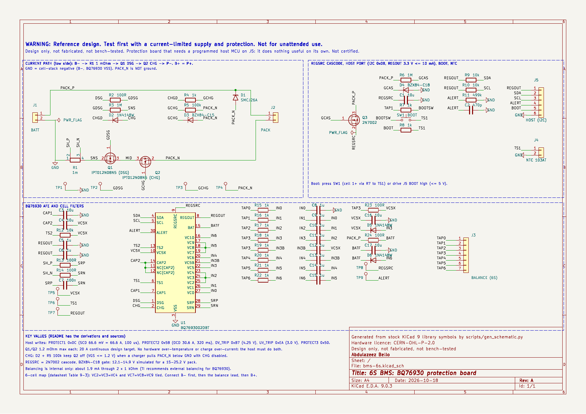
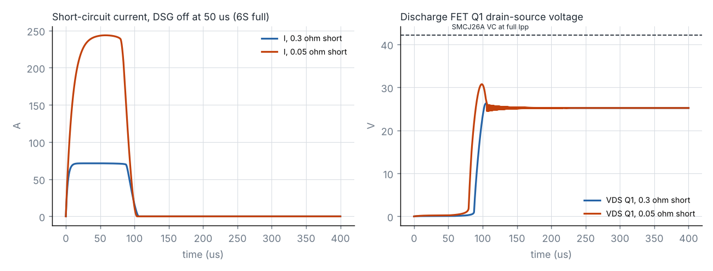

# 6S BMS: BQ76930 protection board

Open-source KiCad reference design by **Abdulazeez Bello**, embedded systems engineer.

> **WARNING — Reference design. Test first with a current-limited supply and protection. Not for unattended use.**
> This board sits between a 6-series Li-ion/LiPo pack and its load or charger. It only protects the pack when a **host microcontroller** (not on this board) has configured the BQ76930 and is supervising it. Do not rely on it as the only protection. Nothing here is certified, and nothing here claims compliance with any safety standard.

**Status: Design only, not fabricated, not bench-tested.**

Schematic generated with AI assistance at my direction; I reviewed pin assignments against the datasheets.



| | |
|---|---|
| Schematic (PDF) | [`docs/bms-6s-schematic.pdf`](docs/bms-6s-schematic.pdf) |
| KiCad project (KiCad 9) | [`hardware/`](hardware/) |
| Bill of materials | [`docs/bms-6s-bom.csv`](docs/bms-6s-bom.csv) |
| ERC report | [`docs/erc.rpt`](docs/erc.rpt) (0 errors, 0 warnings) |
| Calculator | [`scripts/bms_calc.py`](scripts/bms_calc.py), output in [`docs/calc-output.txt`](docs/calc-output.txt) |
| Simulation | [`scripts/run_sims.py`](scripts/run_sims.py), results in [`sim/results.txt`](sim/results.txt) |
| Netlist check | [`scripts/verify_netlist.py`](scripts/verify_netlist.py) (PASS) |

---

## 1. What it does, and what kind of board it is

**This is a protection board, not a monitor-only board.** It carries the current path: a 1 mΩ sense resistor and two low-side MOSFETs (discharge Q1, charge Q2) that the BQ76930 switches. It is also **host-dependent**:

- The BQ76930 is an analogue front end. Its thresholds and delays, and the bits that turn the CHG/DSG FETs on, are written over I²C by a host.
- Once configured, the BQ76930 trips short-circuit (SCD) and discharge over-current (OCD) protection on its own, using hardware comparators. Over- and under-voltage (OV/UV) also trip on their own once the host has turned the ADC on.
- The BQ76930 has **no over-temperature and no charge over-current protection** in hardware. The host must do both, from the TS1 thermistor and the coulomb counter.

So, without a programmed host on J5, the board is not protecting anything. No host firmware is part of this design.

**Ratings (design targets):**

- 6 series cells, 15.0–25.2 V (2.5–4.2 V per cell).
- 20 A continuous discharge. Current trips at about 30.6 A (OCD, 320 ms) and 66.6 A (SCD, 100 µs).
- Charge up to 5 A through the same terminals (common port).

```
B+ ═══════════════════════════════════════════════ P+
B- ═ R1 1 mΩ ═ SNS ═ Q1 (DSG) ═ MID ═ Q2 (CHG) ═ P-        D1 SMCJ26A across P+/P-
          │ Kelvin SH_P/SH_N → 100 Ω/100 nF → SRP/SRN
Balance lead J3 (TAP0..TAP6) → 1 kΩ / 1 µF filters → VC0..VC10 (6-cell map)
U1 BQ7693002: DSG → R2 → Q1 gate;  CHG → D2 → R4 → Q2 gate (R5 100k + D3 15 V to P-)
REGSRC ← Q3 2N7002 cascode (R6 1M, D4 18 V) ← B+;  REGOUT 3.3 V → host on J5
```

GND on the schematic is the cell-stack negative (B−, the BQ76930's VSS). **PACK_N (P−) is not ground.** It floats whenever a FET is off.

## 2. Requirements

| # | Requirement (from the brief) | How it is met |
|---|---|---|
| R1 | 6S BMS (2S dropped, as agreed) | BQ76930 configured for 6 cells per its Table 9-3 (§3.1) |
| R2 | BQ76930 | U1 BQ7693002DBT (3.3 V REGOUT, I²C 0x08, no CRC) |
| R3 | State protection board or monitor-only | Protection board with a host requirement (§1) |
| R4 | Li-ion safety warning | Above, and on the schematic |
| R5 | Nothing from AirChain | Generic topology, parts and net names |

## 3. Design calculations

The numbers come from `python3 scripts/bms_calc.py`; its full output is in `docs/calc-output.txt`. Values marked **[ASSUMPTION]** are not from a datasheet. The BQ76930 numbers are from TI's BQ769x0 datasheet (SLUSBK2I).

### 3.1 Six-cell connection

The BQ76930 has two five-cell groups, and each group needs at least three cells. TI's Table 9-3 gives the six-cell map.

| Group | Cells on | Shorted together |
|---|---|---|
| Lower (VC0–VC5, supply VC5X–VSS) | VC1–VC0, VC2–VC1, VC5–VC4 | VC2 = VC3 = VC4 |
| Upper (VC5B–VC10, supply BAT–VC5X) | VC6–VC5B, VC7–VC6, VC10–VC9 | VC7 = VC8 = VC9 |

- **Group voltages:** each group carries three cells, 7.5–12.6 V. That is inside the recommended 6–25 V per group.
- **Cell voltages:** in-use cells (2.5–4.2 V) are inside the 2–5 V input range.
- **Tied pins:** the tied pins share one filtered input node (IN2 and IN5 on the schematic).
- **Power filters:**
  - VC5X is fed from the cell 3/4 junction (TAP3) through R23 100 Ω + C16 10 µF.
  - BAT is fed from B+ through R24 100 Ω + C17 10 µF.
  - These are the datasheet's typical supply-filter values (40 Ω–1 kΩ, 1–40 µF).
- **Power-pin diodes:** non-Schottky diodes run from the top input of each group to its power pin, as the datasheet requires: D5 from IN3 to VC5X, and D6 from IN6 to BAT.
- **NC pins:** pins 11 and 12 are tied to CAP2, as the pin table says.

### 3.2 Current path

| | At 20 A (continuous) | At 30 A (OCD threshold) |
|---|---|---|
| Each FET (IPT012N08N5, 1.2 mΩ max at 10 V) | 0.48 W, 0.82 W hot **[ASSUMPTION ×1.7]** → +33 K at 40 K/W | 1.08 W / 1.84 W hot (seconds only, before OCD trips) |
| R1 (WSK2512, 1 mΩ, 1 W at 70 °C) | 0.40 W | 0.90 W |
| Path (2 FETs + shunt) | 3.4 mΩ, 68 mV | — |

- **Sense voltage:** SRN reads +20 mV at 20 A discharge and −5 mV at 5 A charge. Both are well inside the ±200 mV recommended range.
- **Coulomb counter:** one LSB (8.44 µV) is 8.44 mA.
- **Ground reference:** VSS connects at the battery side of R1 and SRP takes the Kelvin pad on that side, as the datasheet's sense-input section requires.

### 3.3 Protection settings for the host

These are values for the host firmware to write. They are not on the board. The datasheet's own worked example has register values that disagree by one threshold code with its text. So:

- The SCD/OCD code tables below are rebuilt from the stated range, step and that example.
- Check them against the register map before use.

| Register | Value | Meaning |
|---|---|---|
| PROTECT1 | 0x0C | RSNS = 0, SCD code 4 = 66.6 mV → **66.6 A** (56.9–76.5 A with ±10 % scale, ±2.5 mV offset, 1 % shunt), delay 100 µs |
| PROTECT2 | 0x58 | OCD code 8 = 30.6 mV → **30.6 A** (24.8–36.5 A), delay 320 ms |
| OV_TRIP | 0xB7 | 4.25 V/cell (4.251 V with the typical 382 µV gain; read ADCGAIN/ADCOFFSET and recompute) |
| UV_TRIP | 0xEA | 3.00 V/cell (2.995 V) |
| PROTECT3 | 0x50 | OV delay 2 s, UV delay 4 s (the datasheet's example value) |
| SYS_CTRL1/2 | — | Host sets ADC_EN, TEMP_SEL = 1 (thermistor) and CHG_ON/DSG_ON. The firmware design is not part of this project |

The OV/UV method reproduces the datasheet's own example (4.30 V → 0xBF, 2.5 V → 0x99).

### 3.4 FET drive

- **DSG (Q1):**
  - Driven through R2 100 Ω. The DSG output is 10–14 V when REGSRC ≥ 12 V.
  - Turn-off goes through the internal 1.75–4.25 kΩ pull-down: 34–74 µs into 13–17 nF.
  - R3 1 MΩ holds the gate off when the IC is unpowered.
- **CHG (Q2):** its source is P−, which moves.
  - When CHG is off and a charger is connected, P− is pulled below GND by the difference between the charger and the pack.
  - Through the CHG pin's weak 1 MΩ pull-down, that would turn Q2 on.
  - D2 and R5 100 kΩ fix this. The gate is held to P−, and only the ≥ 750 kΩ internal pull-down sits on the other side, so VGS = ΔV × 100k/850k.
  - At ΔV = 10.2 V (empty pack at 15 V, charger at 25.2 V), VGS = 1.2 V, below VGS(th) min 2.2 V. ngspice agrees: 1.15 V and 12 µA leakage (§5).
  - D2 also protects the CHG pin when P− is pulled up by a load.
  - D3 BZX84-C15 clamps the gate to P−. Turn-off τ is R5 × Ciss = 1.3–1.7 ms.
- **Gate voltage:** the IPT012N08N5 is specified at 6 V (1.7 mΩ) and 10 V (1.2 mΩ). Both drives give ≥ 10 V when REGSRC ≥ 12 V (§3.5).

### 3.5 REGSRC and REGOUT

TI requires a cascode FET between BAT and REGSRC on the BQ76930. The datasheet gives no values, so these are my own:

- **Cascode:** Q3 2N7002 source follower. Its gate is biased by R6 1 MΩ and clamped by D4 BZX84-C18 (16.8–19.1 V at 5 mA).
- **REGSRC voltage:**
  - At about 8–12 µA bias the zener sits below its 5 mA rating **[ASSUMPTION]**.
  - ngspice gives REGSRC = **12.1 V at a 15 V pack and 14.9 V at 25.2 V**, with a 10 mA load. That is inside the 6–25 V range and high enough for full FET drive.
  - With BZX84-C15, the first choice, REGSRC fell to 11.6–11.7 V. That is below the 12 V needed for full FET drive, so I changed to C18.
- **Q3 dissipation:** ≤ 0.13 W at 25.2 V and 10 mA, against 0.83 W Ptot (at Tsp 25 °C).
- **REGOUT (3.3 V version):** 3.2–3.4 V unloaded, ≥ 3.15 V at 10 mA, current limit 30–45 mA. The host budget is **10 mA [ASSUMPTION]**.
  - C5 + C6 give 2 × 1 µF, inside the 1–4.7 µF load range.
  - CAP1, CAP2 and REGSRC each get 10 µF 50 V, so DC-bias derating cannot take them under the 1 µF minimum.

### 3.6 Filters, balancing, boot, thermistors

- **Cell inputs:** Rc = 1 kΩ (500 Ω–1 kΩ allowed) with differential Cc = 1 µF (0.1–10 µF allowed).
  - The datasheet gives values but not the capacitor topology. Differential caps, with C8 from VC0 and C12 from VC5B to their group references, are **my choice**.
- **Sense filter:** R13/R14 100 Ω with C7 100 nF differential, τ = 20 µs. That is short compared with the 70–400 µs SCD delays.
- **Balancing:**
  - The internal balance FETs only, through 2 × 1 kΩ: **about 1.9 mA** (2.1 mA max at 4.2 V), against a 5 mA limit. That is about 31 mAh/day at 70 % duty.
  - TI recommends external balancing for the BQ76930; it is **not fitted** (§4, §7).
- **ALERT:** R11 499 kΩ + C2 470 pF to GND, the datasheet's commonly recommended pair (τ 235 µs, under the 250 µs maximum).
- **Boot:**
  - The BQ76930 starts in SHIP mode. A rising edge on TS1 above VBOOT (0.3–1.0 V) wakes it.
  - SW1 connects cell 1+ (2.5–4.2 V, under the 5 V pre-POR limit) through R7 1 kΩ to TS1, a 4.2 mA pulse. The Omron B3U-1000P is rated 50 mA, 12 V, from the distributor listing.
  - J5 pin 5 (BOOT) does the same through R8.
- **Thermistors:**
  - TS1 takes a 103AT NTC on J4, against the internal 10 kΩ pull-up.
  - TS2 has a fixed 10 kΩ to VC5X (the datasheet requires a resistor). It reads as 25 °C, so the host must ignore TS2.
- **Standby drain:** in SHIP mode, the IC draws 0.6–1.8 µA and the cascode bias about 8 µA, ≈ 0.34 mAh/day.

### 3.7 Pack-terminal transient

D1 SMCJ26A sits across P+/P−: VR 26 V (above 25.2 V), VC 42.1 V at full Ipp, against the FETs' 80 V. The BQ76930 is on the cell side, behind the FETs.

## 4. Decisions and trade-offs

| Decision | Why | What it costs |
|---|---|---|
| Protection board, host on a connector | The BQ76930 cannot run without a host; keeping the MCU off the board keeps the design reusable with any MCU | The board does nothing until firmware exists; that firmware is not part of this project |
| Low-side back-to-back N-FETs, common port | Standard BQ769x0 arrangement; the DSG/CHG outputs are low-side drivers | P− is not ground; charger and load share terminals, so charge over-current is the host's job |
| 2 × IPT012N08N5 (80 V, 1.2 mΩ, TOLL) | Pinout already verified on the drone board; 80 V margin over the TVS clamp | Two large packages; the SOA is a graph only |
| 1 mΩ sense resistor | Puts OCD (30 A) and SCD (60–67 A) inside the threshold ranges; 0.4 W at 20 A | 0.9 W at the OCD point, close to the 1 W rating |
| D2 + R5 100 kΩ CHG drive | Keeps Q2 off when a charger pulls P− below GND; protects the CHG pin when P− goes high | CHG turn-off is 1.3–1.7 ms, slower than DSG |
| 2N7002 + BZX84-C18 cascode | TI requires a cascode; the C18 holds REGSRC ≥ 12 V for full FET drive down to an empty pack | ≈ 8 µA standing bias, even in SHIP mode; my own values, as TI gives none |
| Internal balancing only | Fewer parts; no external balance FET values were available from TI's text | About 1.9 mA, which only trims a nearly balanced pack |
| TS2 with a fixed resistor | One thermistor channel is enough for a first revision | Only one temperature point on the pack |
| Solder pads for B± and P± | Wire gauge stays the builder's choice | No connector MPN |

## 5. Verification done

| Check | Result |
|---|---|
| `kicad-cli sch erc --severity-all` (KiCad 9.0.3) | **0 errors, 0 warnings** |
| Netlist vs design intent (`verify_netlist.py`, 43 nets) | **PASS** |
| Footprints exist in the KiCad 9 libraries | All 15 found |
| ngspice, SCD turn-off at 25.2 V, 0.3 Ω short (71 A) | Q1 turns off in about 55 µs; peak 647 W, **8 mJ**; VDS peak 26.3 V |
| ngspice, hard short 0.05 Ω (243 A) | Peak 3.4 kW, **50 mJ**; VDS peak 30.7 V, below the 42.1 V TVS clamp |
| ngspice, charger on with CHG off (pack 15 / 18 / 22.2 V, charger 25.2 V) | Q2 VGS **1.15 / 0.80 / 0.31 V**, charge current ≤ 12 µA |
| ngspice, REGSRC cascode, 10 mA load | 12.1 V (15 V pack), 14.9 V (22.2 and 25.2 V pack); Q3 0.10 W at 25.2 V |



**What the simulations do not cover:**

- The models are level-1 MOSFETs fitted to RDS(on) max and typical VGS(th), with an assumed Cgd of 0.5 nF.
- The DSG driver is modelled as 12 V through 2.5 kΩ, and the short-circuit loop (1 µH, 50 mΩ pack) is assumed.
- The BQ76930 itself is not modelled. Its SCD delay, comparators and ADC are absent, so the run starts at the moment the driver turns off.
- MOSFET SOA, avalanche and cell chemistry are not modelled.

### Pin-by-pin check

Each row was compared with the manufacturer's pin table and with the exported netlist.

| Ref | Part | Pin → net | Datasheet source | Result |
|---|---|---|---|---|
| U1 | BQ7693002DBT (TSSOP-30) | 1 DSG, 2 CHG, 3 VSS→GND, 4 SDA, 5 SCL, 6 TS1, 7 CAP1, 8 REGOUT, 9 REGSRC, 10 VC5X, 11/12 NC→CAP2, 13 TS2, 14 CAP2, 15 BAT→BATF, 16 VC10→IN6, 17/18/19 VC9/8/7→IN5, 20 VC6→IN4, 21 VC5B→IN3B, 22 VC5→IN3, 23/24/25 VC4/3/2→IN2, 26 VC1→IN1, 27 VC0→IN0, 28 SRP, 29 SRN, 30 ALERT | TI SLUSBK2I BQ76930 pin table + Table 9-3 (6 cells) | ✓ |
| Q1, Q2 | IPT012N08N5 | 1 G, 2 (pins 2–8) S, 3 (tab) D. Q1: S→SNS, D→MID. Q2: S→PACK_N, D→MID | Infineon "Gate Pin 1, Source Pin 2-8, Drain Tab" | ✓ |
| Q3 | 2N7002,215 (SOT-23) | 1 G→GCAS, 2 S→REGSRC, 3 D→PACK_P | NXP/Nexperia Table 2 | ✓ |
| D1 | SMCJ26A | 1 K→PACK_P, 2 A→PACK_N | Littelfuse: cathode band | ✓ |
| D2, D5, D6 | 1N4148W-V-GS08 | 1 K, 2 A. D2: K→CHGD, A→CHG. D5: K→VC5X, A→IN3. D6: K→BATF, A→IN6 | Vishay 85748 | ✓ |
| D3, D4 | BZX84-C15/C18,215 | 3 K, 1 A, 2 n.c. D3: K→GCHG, A→PACK_N. D4: K→GCAS, A→GND | Philips/Nexperia BZX84 pinning | ✓ |
| R1 | WSK2512 1 mΩ | 1 I→GND (battery side), 4 I→SNS, 2 E→SH_P, 3 E→SH_N | Vishay I1/I2, E1/E2; footprint pads 1/4 large, 2/3 small | ✓ |
| J3 | B7B-XH-A | 1→TAP0 (B−) … 7→TAP6 (B+) | **The JST datasheet does not say which balance-lead wire is pin 1** | **Unverified**: check against your pack's lead |
| J4, J5 | SM02B/SM06B-GHS-TB | J5: 1 REGOUT, 2 SDA, 3 SCL, 4 ALERT, 5 BOOT, 6 GND | This board's own pin order | n/a |
| SW1 | B3U-1000P | 1→BOOTSW, 2→TS1 | Two-pad switch, not polarised | ✓ |

## 6. How to test on the bench

Work in this order. **Use resistor-ladder "cells" and current-limited supplies before any real cells.**

1. **Before power.**
   - Check for shorts: P+–P−, P+–GND, every TAPn–TAPn+1.
   - Check that R15–R22 read 1 kΩ in circuit.
2. **Cell simulator.**
   - Build a ladder of six equal resistors (for example 6 × 100 Ω) across a bench supply at 22.2 V, limit 100 mA. Wire the taps to J3 and the ends to B−/B+.
   - Connect B− first, then J3, then B+.
   - TP5 VC5X should read ≈ 11.1 V, TP8 REGSRC 12–15 V, and TP7 REGOUT 0 V (SHIP mode).
3. **Boot.**
   - Press SW1. REGOUT should come up at 3.2–3.4 V.
   - Then read the BQ76930 at I²C 0x08 from a 3.3 V host on J5.
4. **Readback.**
   - Write CC_CFG = 0x19 (required by the datasheet) and set ADC_EN.
   - Read all six cell voltages. Read ADCGAIN/ADCOFFSET and recompute OV_TRIP/UV_TRIP.
5. **FET control, no load.**
   - Set DSG_ON and check TP2 GDSG (10–14 V vs GND).
   - Set CHG_ON and check TP3 GCHG vs PACK_N.
6. **OV/UV.**
   - Raise the ladder supply until one simulated cell passes 4.25 V. CHG should drop after about 2 s.
   - Lower it below 3.0 V/cell. DSG should drop after about 4 s.
7. **OCD.**
   - Use an electronic load on P+/P− with the supply limit raised in steps.
   - Confirm the trip near 30 A (24.8–36.5 A window) after 320 ms. Q1 and R1 must stay below their temperature limits.
8. **SCD.**
   - Only with a supply that can deliver about 70 A and a series fuse.
   - Pulse a low-resistance load and scope GDSG and Q1 VDS.
9. **Charger with CHG off.**
   - Connect a 25.2 V current-limited "charger" to P+/P− with CHG_ON = 0.
   - Q2 VGS should stay below about 1.2 V and the current near zero.
10. **Real cells.** Only after steps 1–9 pass: a fused, balanced pack, on a non-flammable surface, attended.

## 7. Known limitations

- **No host, no protection.** Thresholds, FET enable, over-temperature and charge over-current all need firmware that is not part of this project.
- **The register code tables are reconstructed.** The SCD/OCD code tables come from the datasheet's range, step and worked example, which disagree by one code. Check them against the register map.
- **The default FET state at power-up was not read from the datasheet** (its FET response table was not in the text available to me). Measure it in bench step 3.
- **External balancing is not fitted**, although TI recommends it for the BQ76930. Balancing current is about 1.9 mA.
- **Values TI does not give:** the cascode values, the CHG drive network and the cell-filter capacitor topology are my own design. TI's typical-application schematic values could not be read in text form.
- **Connection order:** random-connection behaviour was not analysed. Connect B− first, then the balance lead, then B+, as noted on the schematic.
- **Graph-only data:** the IPT012N08N5 SOA and RDS(on)-vs-temperature are only graphs. The SCD energy (8–50 mJ simulated) has not been checked against the SOA.
- **Pack connector pinout:** the J3 balance pin order follows the common convention (pin 1 = B−), but packs differ. Check before plugging in.
- **Thermistors:** only one is fitted (TS1); TS2 is a fixed resistor.
- **No layout.** The Kelvin routing of R1, the FET copper and the separation of the high-current path from the cell-sense traces decide whether these numbers hold.

## 8. Bill of materials

Full CSV: [`docs/bms-6s-bom.csv`](docs/bms-6s-bom.csv). **MPN check:**

- Checked against a datasheet in this or an earlier design: U1, Q1–Q3, D1–D6, R1, the JST connectors and the Murata parts GRM32ER71H106KA12L, GRM188R71C105KA12D and GRM188R71H104KA93D.
- Built from manufacturer naming rules but **not individually checked**:
  - WSK25121L000FEA (Vishay's "L" rule).
  - GRM1885C1H471JA01D.
  - The Yageo RC0603 codes.
- **Omron B3U-1000P:** the rating is from a distributor listing, not the Omron datasheet.

| Refs | Qty | Value | Part (MPN) | Manufacturer |
|---|---|---|---|---|
| U1 | 1 | BQ76930, 3.3 V, 0x08 | BQ7693002DBT | Texas Instruments |
| Q1, Q2 | 2 | 80 V 1.2 mΩ | IPT012N08N5ATMA1 | Infineon |
| Q3 | 1 | 60 V | 2N7002,215 | Nexperia |
| D1 | 1 | TVS 26 V | SMCJ26A | Littelfuse |
| D2, D5, D6 | 3 | 1N4148W | 1N4148W-V-GS08 | Vishay |
| D3 / D4 | 1 / 1 | Zener 15 V / 18 V | BZX84-C15,215 / BZX84-C18,215 | Nexperia |
| R1 | 1 | 1 mΩ 1 W | WSK25121L000FEA | Vishay Dale |
| C1, C3, C4, C16, C17 | 5 | 10 µF 50 V X7R 1210 | GRM32ER71H106KA12L | Murata |
| C5, C6, C8–C15 | 10 | 1 µF 16 V X7R 0603 | GRM188R71C105KA12D | Murata |
| C7 | 1 | 100 nF 50 V X7R 0603 | GRM188R71H104KA93D | Murata |
| C2 | 1 | 470 pF 50 V C0G 0603 | GRM1885C1H471JA01D | Murata |
| R2–R24 | 23 | 0603 1 % (100 Ω, 1 k, 10 k, 100 k, 499 k, 1 M) | RC0603FR-07xxxL (see CSV) | Yageo |
| SW1 | 1 | Boot button | B3U-1000P | Omron |
| J3 | 1 | Balance, 7-pin XH | B7B-XH-A(LF)(SN) | JST |
| J4 / J5 | 1 / 1 | GH 2-pin / 6-pin | SM02B-GHS-TB(LF)(SN) / SM06B-GHS-TB(LF)(SN) | JST |
| TP1 / TP2–TP9 | 1 / 8 | Test point black / red | 5001 / 5000 | Keystone |
| J1, J2 | 2 | B± / P± wire pads | PCB pads, no part | — |
| (off-board) | 1 | 10 kΩ NTC on the cells | 103AT type, B25/85 = 3435 K | Semitec (as in the solar charger) |

## 9. Open assumptions

1. Cell chemistry: Li-ion/LiPo NMC, 2.5–4.2 V. Change OV/UV for LiFePO4.
2. Host draws ≤ 10 mA from REGOUT.
3. RDS(on) ×1.7 at a hot junction.
4. Zener voltage at 8–12 µA bias (cascode) and 2N7002 VGS ≈ 2.5–3 V at 10 mA.
5. Short-circuit loop of 1 µH and pack resistance of 50 mΩ (simulation only).
6. Cgd = 0.5 nF in the MOSFET model.

## 10. Datasheets used

TI BQ769x0 (SLUSBK2I: pin table, Table 9-3, recommended operating conditions, electrical characteristics, sections 8.3.1.3 and 9.1, design procedure) · TI SLUA749A (BQ769x0 top design considerations) · Infineon IPT012N08N5 (v2.1) · NXP/Nexperia 2N7002 · Philips/Nexperia BZX84 series · Vishay 1N4148W (85748) · Littelfuse SMCJ series · Vishay WSK2512 · JST XH (eXH) · JST GH (eGH) · Omron B3U-1000P (distributor listing). The URLs are in each symbol's Datasheet field and in `scripts/gen_schematic.py`.

## 11. Rebuild

```sh
KICAD_CLI=kicad-cli SYMDIR=/usr/share/kicad/symbols sh scripts/build.sh   # schematic, ERC, netlist check, PDF, BOM
python3 scripts/bms_calc.py                                                # calculations and register values
NGSPICE=ngspice python3 scripts/run_sims.py                                # simulations (waveforms in sim/, git-ignored)
```

## 12. Licence

- Scripts (`scripts/`): MIT, see `LICENSE-MIT.txt`.
- Hardware (schematic, project, BOM, `sim/models.lib`): CERN-OHL-P-2.0, see `LICENSE-CERN-OHL-P-2.0.txt`.
