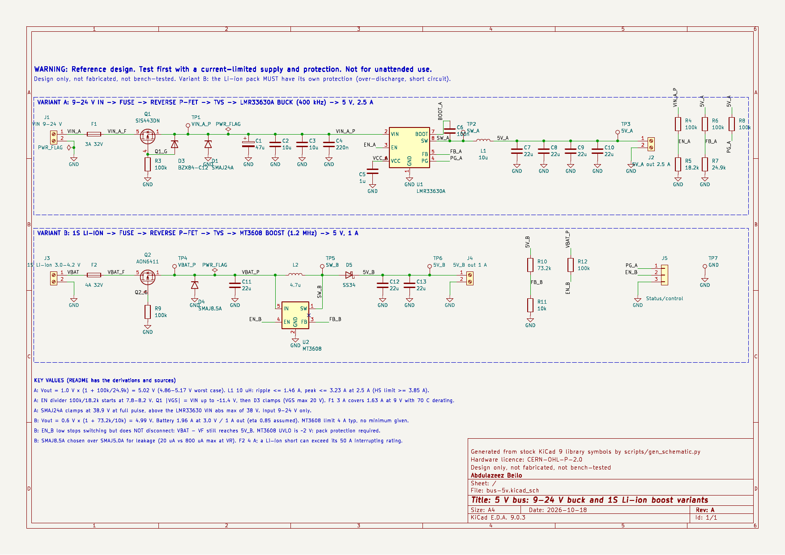
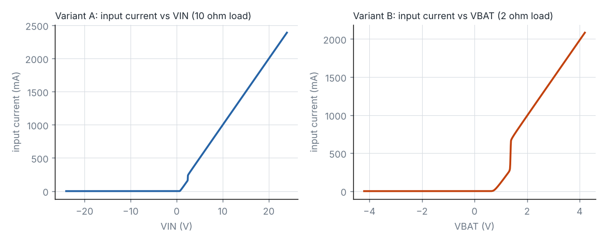
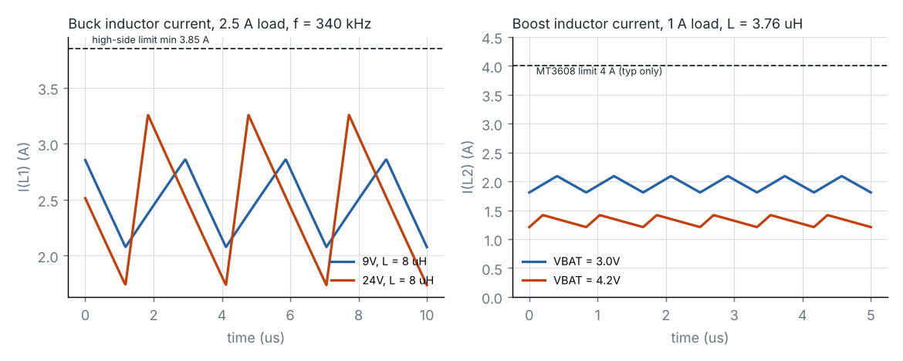

# 5 V bus: 9–24 V buck and 1S Li-ion boost

Open-source KiCad reference design by **Abdulazeez Bello**, embedded systems engineer.

> **WARNING — Reference design. Test first with a current-limited supply and protection. Not for unattended use.**
> Variant B runs from a 1S Li-ion cell. **The cell or pack must have its own protection circuit** (over-discharge, over-current, short circuit); this board does not provide it. Nothing here is certified or claims compliance with any safety standard.

**Status: Design only, not fabricated, not bench-tested.**

Schematic generated with AI assistance at my direction; I reviewed pin assignments against the datasheets.



| | |
|---|---|
| Schematic (PDF) | [`docs/bus-5v-schematic.pdf`](docs/bus-5v-schematic.pdf) |
| KiCad project (KiCad 9) | [`hardware/`](hardware/) |
| Bill of materials | [`docs/bus-5v-bom.csv`](docs/bus-5v-bom.csv) |
| ERC report | [`docs/erc.rpt`](docs/erc.rpt) |
| Calculator | [`scripts/bus5v_calc.py`](scripts/bus5v_calc.py), output in [`docs/bus5v_calc_output.md`](docs/bus5v_calc_output.md) |
| Simulations | [`scripts/run_sims.py`](scripts/run_sims.py), results in [`sim/results.txt`](sim/results.txt) |

---

## 1. What it does

It makes a 5 V bus from one of two sources. Both variants are drawn on the same sheet; you build one.

| | Variant A | Variant B |
|---|---|---|
| Input | 9–24 V DC (adapter, 12 V or 24 V system) | 1S Li-ion, 3.0–4.2 V |
| Converter | TI LMR33630A synchronous buck, 400 kHz | Aerosemi MT3608 boost, 1.2 MHz |
| Output | 5 V, 2.5 A continuous | 5 V, 1 A |
| Protection | Fuse → reverse-blocking P-FET (with gate clamp) → TVS | Fuse → reverse-blocking P-FET → TVS |
| Bulk caps | 47 µF electrolytic + 2 × 10 µF + 220 nF in; 4 × 22 µF out | 22 µF in; 2 × 22 µF out |
| Extras | Under-voltage start (≈ 8 V), power-good output | Enable input |

```
A: VIN ─ F1 ─ Q1 (P-FET, D→S) ─┬─ D1 TVS ─┬─ C1..C4 ─ U1 LMR33630A ─ L1 10 µH ─ C7..C10 ─ 5V_A
                    gate: R3 to GND, D3 12 V clamp to source
B: VBAT ─ F2 ─ Q2 (P-FET, D→S) ─┬─ D4 TVS ─ C11 ─ L2 4.7 µH ─┬─ D5 SS34 ─ C12, C13 ─ 5V_B
                    gate: R9 to GND                 U2 MT3608 SW ┘
```

## 2. Requirements

| # | Requirement (brief) | How it is met |
|---|---|---|
| R1 | 9–24 V input variant | LMR33630A, rated 3.8–36 V in (abs max 38 V) |
| R2 | 1S Li-ion variant | MT3608, rated 2–24 V in |
| R3 | Fuse or PTC | Littelfuse 466-series 1206 fuses: 3 A (A), 4 A (B). A PTC rated for 24 V in 1206 was not found among the parts read, so fuses are used |
| R4 | P-FET reverse protection | Q1 SiS443DN (−40 V) with a 12 V gate clamp; Q2 AON6411 (−20 V, specified at VGS = −2.5 V) |
| R5 | TVS | SMAJ24A (A), SMAJ8.5A (B) |
| R6 | Buck or boost | Buck for A, boost for B |
| R7 | Bulk caps | See §3.5 and §3.10 |
| R8 | Nothing from AirChain | Generic nets and parts |

## 3. Design calculations

All numbers come from `python3 scripts/bus5v_calc.py`. Datasheet values are listed with their source in §10. Values marked **[ASSUMPTION]** are not from a datasheet.

### Variant A: buck

#### 3.1 Output voltage

The LMR33630 reference is V_FB = 0.985–1.015 V. With R6 = 100 kΩ and R7 = 24.9 kΩ (the values in the datasheet example):

- V_OUT = 1.0 × (1 + 100/24.9) = **5.016 V** typical.
- Worst case, with ±1.5 % reference and ±1 % resistors: **4.86–5.17 V**.

#### 3.2 Switching

- **Frequency.** The A version runs at 340–460 kHz.
- **On-time and off-time.** At 24 V in, D = 0.208 and t_on = 613 ns at 340 kHz. At 9 V in, t_off = 1.31 µs. Both are far above the minimum on-time (≤ 108 ns) and minimum off-time (≤ 85 ns).
- **No dropout concern.** The minimum input is 9 V for a 5 V output.

#### 3.3 Inductor (Coilcraft XAL6060-103, 10 µH ±20 %)

Worst-case ripple uses L at −20 % and f at its 340 kHz minimum:

| VIN | Ripple | Peak at 2.5 A | Valley |
|---|---|---|---|
| 9 V | 0.82 A | 2.91 A | 2.09 A |
| 12 V | 1.07 A | 3.04 A | 1.96 A |
| 24 V | 1.46 A | **3.23 A** | 1.77 A |

- **Peak against current limit.** The 3.23 A worst-case peak sits below the high-side current limit minimum of **3.85 A**. This margin is why the continuous rating is **2.5 A**, not the IC's 3 A: at 3 A the worst-case peak would be 3.73 A, only 0.12 A below the limit.
- **Saturation.** I_sat is 7.6 A (30 % drop, typical), above the current-limit maximum of 5.05 A, as the datasheet requires.
- **DCR loss.** 29.8 mΩ max gives 186 mW at 2.5 A.

#### 3.4 Output capacitors

- **Fitted:** 4 × 22 µF 16 V X7R 1210, as in the datasheet's 5 V design example.
- **Effective capacitance:** **[ASSUMPTION]** about 70 µF after DC-bias derating at 5 V. The Murata bias curve was not read.
- **Ripple:** ΔV ≈ ΔI / (8 f C) = **7.6 mV** worst case, capacitive term only.

#### 3.5 Input capacitors

The datasheet asks for at least 10 µF of ceramic rated for the maximum VIN (ideally 2×), plus 220 nF close to the pins.

- **C2, C3 (2 × 10 µF 50 V X7R 1210).** Two parts, so that at least 10 µF remains after DC-bias derating at 24 V **[ASSUMPTION: derating not read from Murata]**.
- **C4 (220 nF 50 V).** The high-frequency bypass close to the pins.
- **C1 (47 µF 50 V electrolytic).** Its ESR damps the LC ringing between a long input cable and the MLCCs at hot-plug.
- **Ripple current.** The worst-case input RMS ripple current is 1.25 A, at D = 0.5.

#### 3.6 Enable, power-good, VCC, BOOT

- **EN divider, R4 = 100 kΩ / R5 = 18.2 kΩ.** EN rises at 1.200–1.260 V, which starts the converter at **7.79–8.18 V** of input. It stops at about 7.35 V (100 mV hysteresis). At 24 V in, EN sits at 3.70 V, within its VIN + 0.3 V limit.
- **PG.** Open-drain, pulled up to 5V_A by R8 = 100 kΩ, giving 50 µA when low. V_OL ≤ 0.2 V is specified at exactly 50 µA. PG is high between 92–95 % and 105–108 % of the regulated output.
- **VCC.** C5 = 1 µF, per the datasheet. Do not load this pin.
- **BOOT.** C6 = 100 nF, per the datasheet.

#### 3.7 Losses and heat (rough)

- **IC conduction loss** at 2.5 A with maximum R_DS(on) (160 mΩ high-side, 110 mΩ low-side): **0.86 W at 9 V** and 0.75 W at 24 V.
- **Switching loss** is not included. The datasheet gives only efficiency curves.
- The datasheet R_θJA of 42.9 °C/W is a JEDEC comparison value that TI says not to use for design. The real temperature depends on copper area and must be measured (§7).

#### 3.8 Input protection

- **F1 (Littelfuse 0466003, 3 A, 32 V).** Input current at 9 V and 2.5 A out is 1.63 A **[ASSUMPTION: 85 % efficiency]**. Littelfuse's derating (0.75 continuous × 0.80 at 70 °C) needs a fuse of at least 2.72 A, so 3 A was chosen. Its 32 V rating exceeds the 24 V maximum input.
- **Q1 (Vishay SiS443DN, P-channel, −40 V, V_GS ±20 V).**
  - Orientation: drain on the connector side, source on the protected rail. The body diode conducts at power-up, and then the gate is pulled to GND through R3.
  - Gate drive: |V_GS| = VIN up to about 11.4 V. Above that, D3 (BZX84-C12, 11.4–12.7 V at 5 mA) clamps it, well inside the ±20 V rating.
  - Zener current at 24 V is 0.13 mA.
  - R_DS(on) is ≤ 16 mΩ (specified at −4.5 V; the gate here gets ≥ 9 V), so Q1 dissipates 43 mW at 1.63 A.
  - If the input is reversed, the gate sits at 0 V and the body diode is reverse-biased. Q1 blocks up to −24 V, inside its −40 V rating.
- **D1 (SMAJ24A).** V_R = 24 V, V_BR 26.7–29.5 V.
  - It sits *after* Q1, so a reversed input does not forward-bias it and blow the fuse.
  - **V_C = 38.9 V at the full 10.3 A pulse exceeds the LMR33630's 38 V absolute maximum by 0.9 V.** Smaller surges clamp lower. This is a known limitation (§8).

### Variant B: boost

#### 3.9 Output voltage and duty

- **Output voltage.** The MT3608 reference is V_FB = 0.588–0.612 V. With R10 = 73.2 kΩ and R11 = 10 kΩ, V_OUT = **4.992 V** typical and 4.81–5.18 V worst case.
- **Duty cycle.** D = 1 − VIN / (V_OUT + V_F) is 0.455 at 3.0 V and 0.236 at 4.2 V, well below the 90 % typical maximum.

#### 3.10 Currents, inductor and capacitors

**[ASSUMPTION]** 85 % efficiency, including the SS34 drop. The datasheet gives no efficiency table.

| VBAT | Battery current at 1 A out | Ripple (L −20 %) | Peak |
|---|---|---|---|
| 3.0 V | 1.96 A | 0.30 A | **2.11 A** |
| 3.7 V | 1.59 A | 0.27 A | 1.72 A |
| 4.2 V | 1.40 A | 0.22 A | 1.51 A |

- **Peak against the MT3608's limits.** The switch current limit is **4 A typical, with no minimum specified**, and the peak switch current absolute maximum is 4 A. The design peak of 2.11 A leaves margin against the typical figure only.
- **Inductor.** XAL5030-472: 4.7 µH ±20 %, I_sat 6.7 A, DCR ≤ 40 mΩ. The datasheet recommends 4.7–22 µH.
- **Diode.** D5 is an SS34 carrying 1 A average and 2.1 A peak. It dissipates ≤ 0.5 W, using the 3 A V_F point as a bound.
- **Capacitors.** C11 (in) and C12, C13 (out) are 22 µF each, as the datasheet recommends. Output ripple is about 12 mV from the capacitance alone at 3.0 V and 1 A **[ASSUMPTION: 35 µF effective]**, plus about 6 mV from ESR. ngspice gives 17 mV p-p.
- **Frequency.** The MT3608 datasheet gives only a typical 1.2 MHz. All B-variant ripple figures use that value.

#### 3.11 Input protection

- **F2 (Littelfuse 0466004, 4 A, 32 V).** The battery current of 1.96 A needs ≥ 3.27 A after derating, so 4 A was chosen.
  - **The fuse's interrupting rating is 50 A.** A healthy Li-ion cell can deliver more than that into a hard short, so the fuse may not clear safely. This is why the pack must carry its own protection.
- **Q2 (AOS AON6411, P-channel, −20 V, V_GS ±12 V).** This part was chosen because R_DS(on) is specified at the low gate voltage a single cell provides: **≤ 3.6 mΩ at V_GS = −2.5 V** (V_GS(th) ≤ 1.3 V).
  - |V_GS| equals VBAT, at least 3.0 V. Q2 dissipates 14 mW at 1.96 A.
  - No gate clamp is needed, because 4.2 V is well inside ±12 V.
  - A reversed cell is blocked.
  - Two other parts were considered and rejected:
    - TI CSD25402Q3A (its pinout could not be confirmed: the datasheet text and the KiCad symbol disagree).
    - Vishay Si7617DN (R_DS(on) is not specified below 4.5 V).
- **D4 (SMAJ8.5A).** V_R = 8.5 V, V_C = 14.4 V, below the MT3608's 26 V absolute maximum.
  - **Leakage drove this choice:** I_R ≤ 20 µA at V_R, against up to 800 µA for an SMAJ5.0A. On a battery, that leakage is a permanent drain.
  - At 4.2 V the real leakage is lower, but it is not specified.

#### 3.12 What variant B does not do

- **Enable does not disconnect the battery.** With EN_B low, the MT3608 stops switching, but the battery still reaches 5V_B through L2 and D5, at about VBAT − 0.3 V. A non-synchronous boost has no disconnect.
- **No over-discharge protection.** The MT3608's UVLO is about 1.98 V, far below a safe Li-ion cut-off, so it will keep drawing from a flat cell.
- **No output short-circuit protection.** A short on 5V_B pulls battery current through L2 and D5 with nothing in the path to stop it except F2.

## 4. Decisions and trade-offs

| Decision | Why (datasheet basis) | What it costs |
|---|---|---|
| LMR33630A at 400 kHz | 3.8–36 V in; t_on and t_off far above their minima across 9–24 V; TI's 5 V example uses 400 kHz | Bigger inductor than the 1.4 MHz B version |
| 2.5 A continuous rating (IC is 3 A) | Keeps the worst-case peak (3.23 A) under the 3.85 A minimum high-side limit | 0.5 A of headroom unused |
| L1 10 µH XAL6060 | Ripple ≤ 1.46 A worst case; I_sat 7.6 A > 5.05 A current-limit maximum | 6 × 6 mm footprint; 186 mW DCR loss |
| 4 × 22 µF output | Matches the datasheet example; ripple ~8 mV | Board area; real capacitance depends on DC bias |
| 47 µF electrolytic on the input | Damps cable–MLCC ringing at hot-plug | Height; limited life when hot |
| EN UVLO at ~8 V | Stops brown-out operation below the 9 V specification | Two resistors; ~0.2 mA divider current at 24 V |
| SiS443DN with 12 V zener gate clamp | V_DS −40 V covers a reversed 24 V input; the clamp keeps V_GS ≤ 12.7 V | Three extra parts versus a series Schottky; a slow gate on reverse hot-plug (100 kΩ) |
| TVS after the reverse FET | A reversed input does not forward-bias the TVS and blow the fuse | Positive surges reach the TVS only through Q1 |
| SMAJ24A on 24 V | V_R matches the 24 V maximum | V_C 38.9 V exceeds the LMR33630's 38 V abs max at full pulse |
| MT3608 boost | Stock KiCad symbol, 2–24 V in, 1.2 MHz, small | Datasheet gives typical values only for frequency and current limit; no disconnect; external Schottky |
| SS34 boost rectifier | 3 A, 40 V; V_F ≤ 0.5 V at 3 A; Vishay datasheet available | About 0.5 W at 1 A, roughly 10 % of output power |
| AON6411 for 1S reverse protection | R_DS(on) specified at −2.5 V (3.6 mΩ) | Large DFN 5×6 for a 2 A job |
| SMAJ8.5A instead of SMAJ5.0A | Leakage 20 µA vs 800 µA max at V_R | Higher clamp voltage (14.4 V), still below the MT3608's 26 V abs max |
| Fuses rather than PTCs | Voltage and current ratings read from the datasheet; 32 V covers 24 V | One-time device; 50 A interrupting rating is marginal against a Li-ion short |

## 5. Bill of materials

Generated with `kicad-cli sch export bom` → [`docs/bus-5v-bom.csv`](docs/bus-5v-bom.csv). Build only the variant you need: parts with refs from the "A" row of the schematic, or from the "B" row.

| Ref | Value | Package | Manufacturer | MPN | Variant |
|---|---|---|---|---|---|
| U1 | LMR33630A | HSOIC-8 PowerPAD | Texas Instruments | LMR33630ADDAR | A |
| L1 | 10 µH | XAL6060 | Coilcraft | XAL6060-103MEC | A |
| Q1 | SiS443DN | PowerPAK 1212-8 | Vishay Siliconix | SiS443DN-T1-GE3 | A |
| D3 | BZX84-C12 | SOT-23 | Nexperia | BZX84-C12,215 | A |
| D1 | SMAJ24A | SMA | Littelfuse | SMAJ24A | A |
| F1 | 3 A 32 V | 1206 | Littelfuse | 0466003.NRHF | A |
| C1 | 47 µF 50 V | 6.3 × 7.7 mm electrolytic | Panasonic | EEE-FK1H470P | A |
| C2, C3 | 10 µF 50 V X7R | 1210 | Murata | GRM32ER71H106KA12L | A |
| C4 | 220 nF 50 V X7R | 0603 | Murata | GRM188R71H224KAC4D | A |
| C5 | 1 µF 16 V X7R | 0603 | Murata | GRM188R71C105KA12D | A |
| C6 | 100 nF 50 V X7R | 0603 | Murata | GRM188R71H104KA93D | A |
| C7–C10 | 22 µF 16 V X7R | 1210 | Murata | GRM32ER71C226KE18L | A |
| R3, R4, R6, R8 | 100 kΩ 1 % | 0603 | Yageo | RC0603FR-07100KL | A |
| R5 | 18.2 kΩ 1 % | 0603 | Yageo | RC0603FR-0718K2L | A |
| R7 | 24.9 kΩ 1 % | 0603 | Yageo | RC0603FR-0724K9L | A |
| J1, J2 | 2-way screw terminal | THT | Phoenix Contact | 1715721 | A |
| TP1–TP3 | Test point | THT | Keystone | 5000 | A |
| U2 | MT3608 | SOT-23-6 | Aerosemi | MT3608 | B |
| L2 | 4.7 µH | XAL5030 | Coilcraft | XAL5030-472MEC | B |
| Q2 | AON6411 | DFN 5×6 | Alpha & Omega | AON6411 | B |
| D4 | SMAJ8.5A | SMA | Littelfuse | SMAJ8.5A | B |
| D5 | SS34 | SMC (DO-214AB) | Vishay | SS34-E3/57T | B |
| F2 | 4 A 32 V | 1206 | Littelfuse | 0466004.NRHF | B |
| C11–C13 | 22 µF 16 V X7R | 1210 | Murata | GRM32ER71C226KE18L | B |
| R9, R12 | 100 kΩ 1 % | 0603 | Yageo | RC0603FR-07100KL | B |
| R10 | 73.2 kΩ 1 % | 0603 | Yageo | RC0603FR-0773K2L | B |
| R11 | 10 kΩ 1 % | 0603 | Yageo | RC0603FR-0710KL | B |
| J3, J4 | 2-way screw terminal | THT | Phoenix Contact | 1715721 | B |
| TP4–TP6 | Test point | THT | Keystone | 5000 | B |
| J5 | 1×3 header | THT | generic | — | both (1 = PG_A, 2 = EN_B, 3 = GND) |
| TP7 | Test point, black | THT | Keystone | 5001 | both |

Larger capacitor sizes (1210, electrolytic) are used where the brief's "bulk caps" item needs them; all other passives are 0603. MPN suffixes follow each manufacturer's ordering scheme. Confirm stock and lifecycle status at a distributor; Farnell lists 0466003.NR as no longer stocked, which is why the halogen-free .NRHF code is used.

## 6. Pin-by-pin check

| Part | Datasheet pinning | KiCad symbol pin → net | Result |
|---|---|---|---|
| U1 LMR33630 DDA (SNVSAN3F) | 1 PGND, 2 VIN, 3 EN, 4 PG, 5 FB, 6 VCC, 7 BOOT, 8 SW, pad AGND | 1 GND, 2 VIN_A_P, 3 EN_A, 4 PG_A, 5 FB_A, 6 VCC_A, 7 BOOT_A, 8 SW_A, 9 (pad) GND | Matches. KiCad names pins 1 and 9 both "GND"; the datasheet calls them PGND and AGND, both to ground |
| U2 MT3608 (V1.0) | 1 SW, 2 GND, 3 FB, 4 EN, 5 IN, 6 NC | 1 SW_B, 2 GND, 3 FB_B, 4 EN_B, 5 VBAT_P, 6 no-connect flag | Matches |
| Q1 SiS443DN (63253 rev C) | 1–3 S, 4 G, 5–8 D | 1–3 → VIN_A_P, 4 → Q1_G, 5 → VIN_A_F | Matches (bottom pad = drain, from Vishay AN822 and the footprint) |
| Q2 AON6411 (rev 1.1) | 1–3 S, 4 G, 5–8 D | 1–3 → VBAT_P, 4 → Q2_G, 5 → VBAT_F | Matches. The AO DFN footprint merges pins 5–8 and the pad into pad 5 |
| D3 BZX84-C12 | 1 A, 2 n.c., 3 K | 1 → Q1_G, 2 unconnected, 3 → VIN_A_P | Matches. Cathode at the source, so it clamps V_SG |
| D1 SMAJ24A, D4 SMAJ8.5A | Cathode band | Pin 1 (bar side in the symbol graphic) → rail, pin 2 → GND; `D_SMA` pad 1 = cathode | Matches |
| D5 SS34 (SMC) | Cathode band | 1 (K) → 5V_B, 2 (A) → SW_B; `D_SMC` pad 1 = cathode | Matches. Footprint overridden from the library default SMA |

`scripts/verify_netlist.py` checks every one of these nets in the exported netlist.

## 7. How to test it on the bench

**Equipment.** A current-limited bench supply. An electronic load. A DMM. An oscilloscope with a short ground spring for the switch nodes. A thermocouple or thermal camera. For variant B, start from the bench supply set to 3.7 V; move to a **protected** 1S cell only after every step passes.

### Variant A

1. **Unpowered.** Measure resistance from 5V_A to GND: it should be high, roughly 125 kΩ through the feedback divider. Diode-test the Q1 body diode from J1+ to TP1: about 0.6 V forward.
2. **Reverse polarity.** Apply −12 V to J1 with a 50 mA current limit. Expect no current (≤ µA) and TP1 ≈ 0 V.
3. **First power-up.** Apply 12 V with a 200 mA limit and no load. Expect:
   - TP1 ≈ 12 V (Q1 on).
   - TP3 = 4.86–5.17 V.
   - PG_A high, about 5 V.
   - No-load input current of a few mA (not specified; record it).
4. **Under-voltage lockout.** Ramp VIN from 6 V upward. The output should start at 7.8–8.2 V and stop again at about 7.3 V on the way down.
5. **Load steps.** At 9, 12 and 24 V in (raise the current limit to 2 A), load 0.5, 1.5 and 2.5 A. Record V_OUT, input current (for efficiency) and the SW_A waveform at TP2. Expect a 340–460 kHz switching frequency and output ripple of the order of 10 mV.
6. **Thermal.** After 10 minutes at 24 V in and 2.5 A out, record the U1 and L1 case temperatures.

### Variant B

7. **Reverse polarity.** −3.7 V on J3, 50 mA limit. Expect no current.
8. **First power-up.** 3.7 V, 300 mA limit, no load. Expect 5V_B = 4.81–5.18 V.
9. **Load.** At 3.0, 3.7 and 4.2 V in (raise the limit to 2.5 A), load 0.25, 0.5 and 1 A. Record battery current and V_OUT. At 3.0 V and 1 A, expect about 2 A from the supply.
10. **Enable.** Pull EN_B (J5-2) low. Switching stops, and 5V_B falls to about VBAT − 0.3 V. **It does not turn off; this is expected (§3.12).**

## 8. Known limitations

- **TVS clamp versus U1's absolute maximum.** At full rated pulse, the SMAJ24A clamps at 38.9 V, above U1's 38 V limit. For harsh 24 V systems, reduce the maximum input or add a series element.
- **The MT3608 datasheet is thin.** Frequency and current limit are typical values only, there is no efficiency table, and its θ_JA was not found. The variant B margins rest on typical numbers.
- **No disconnect, no UVLO suited to Li-ion, and no short-circuit protection in variant B.** The pack's own protection is mandatory.
- **Fuse versus Li-ion short.** The fuse's 50 A interrupting rating may be exceeded by a Li-ion short-circuit current.
- **Efficiency was assumed (85 %) for fuse sizing.** Measure it in bench step 5.
- **Capacitor DC-bias derating was assumed.** The Murata curves were not read.
- **Thermal behaviour is not predicted.** TI's θ_JA is for comparison only. Measure it.
- **Only the schematic exists.** There is no PCB layout. For both converters the layout dominates EMI and stability. Follow TI's layout guidance for the LMR33630: input caps tight to VIN/PGND, and a small SW node.

## 9. Verification done (design stage only)

- **ERC.** KiCad 9.0.3 `kicad-cli sch erc --severity-all`: **0 errors, 0 warnings** ([`docs/erc.rpt`](docs/erc.rpt)). The library-symbol check confirms every embedded symbol matches the stock KiCad 9 library.
  - One error was found and fixed along the way: two PWR_FLAGs on the GND net. Only one is kept.
- **Netlist.** `scripts/verify_netlist.py` checks all 20 named nets, plus the two pins that must stay unconnected. It passes.
- **Footprints.** Every footprint exists in the KiCad 9 libraries.
- **Pin assignments.** See §6.

### ngspice 44.2

The models are behavioural ([`sim/models.lib`](sim/models.lib)). The power stages run **open loop**, with ideal switches set to the datasheet maximum on-resistance. Results are in [`sim/results.txt`](sim/results.txt).

| Simulation | Result | Hand calculation |
|---|---|---|
| A protection, −24 V input | Input current ≈ −24 pA; rail stays at 0 V | Blocked |
| A protection, 9 V / 0.9 A | Drop 22.7 mV (fuse + Q1) | 0.9 A × (20 + 16 mΩ) ≈ 32 mV max |
| A protection, 24 V / 2.4 A | Drop 56.5 mV; V_GS = −11.9 V (clamped) | V_GS clamp 11.4–12.7 V |
| B protection, −4.2 V input | Input current ≈ −4 pA | Blocked |
| B protection, 3.0 V / 1.49 A | Drop 24.7 mV | 1.49 A × (14 + 3.6 mΩ) = 26 mV |
| Buck, 24 V in, L = 8 µH, 340 kHz, 2.5 A | Ripple 1.52 A, **peak 3.26 A**, output 8.9 mV p-p | 1.46 A, 3.23 A, 7.6 mV (capacitive term only) |
| Buck, 9 V in, L = 8 µH | Ripple 0.79 A, peak 2.86 A | 0.82 A, 2.91 A |
| Boost, 3.0 V in, L = 3.76 µH, 1 A | Ripple 0.28 A, **peak 2.09 A**, battery current 1.95 A; conduction-only stage efficiency 85.2 % | 0.30 A, 2.11 A, 1.96 A (85 % assumed) |
| Boost, 4.2 V in | Ripple 0.21 A, peak 1.42 A; stage efficiency 90.7 % | 0.22 A, 1.51 A |
| Boost output ripple, 3.0 V | 17 mV p-p per cycle over the last 10 µs | 11.6 mV capacitive + about 6 mV ESR |

The boost output's p-p figure across the whole 1.2–1.5 ms window is 35 mV. That figure includes a slow LC settling oscillation, which appears only because the stage runs open loop.




### What the simulation does not verify

- **The real controllers.** These include:
  - the LMR33630 and MT3608 control loops, so stability and transient response are unchecked;
  - soft-start and inrush current;
  - current limiting;
  - the PG and EN behaviour;
  - switching and gate-drive losses.

  No vendor model was used.
- **Efficiency.** The 85.2 % boost "stage efficiency" covers conduction loss only, so real efficiency is lower. F2 still covers this: at 80 % efficiency the battery current would be 2.08 A, inside the 2.4 A the 4 A fuse can carry continuously at 70 °C.
- **Temperature.** Thermal behaviour was not simulated.
- **Diode model.** The SS34 model is fitted to a single datasheet point (0.5 V at 3 A). Its I_S and N are assumed.
- **TVS clamping.** It was not simulated against a surge waveform.

## 10. Sources

- Texas Instruments, *LMR33630 SIMPLE SWITCHER 3.8 V to 36 V, 3 A Synchronous Buck*, SNVSAN3F (Nov 2020): [ti.com](http://www.ti.com/lit/ds/symlink/lmr33630.pdf)
- Aerosemi, *MT3608 High Efficiency 1.2 MHz 2 A Step Up Converter*, V1.0: [PDF (Olimex mirror)](https://www.olimex.com/Products/Breadboarding/BB-PWR-3608/resources/MT3608.pdf)
- Vishay Siliconix, *SiS443DN*, doc 63253 Rev C: [vishay.com](https://www.vishay.com/docs/63253/sis443dn.pdf)
- Alpha & Omega Semiconductor, *AON6411*, Rev 1.1 (Sept 2023): [aosmd.com](http://www.aosmd.com/res/data_sheets/AON6411.pdf)
- Nexperia, *BZX84 series* Rev 7: [nexperia.com](https://assets.nexperia.com/documents/data-sheet/BZX84_SER.pdf)
- Vishay, *SS32 thru SS36*, doc 88751: [vishay.com](https://www.vishay.com/docs/88751/ss32.pdf)
- Littelfuse, *SMAJ series* (rev 10/21/20): [PDF](https://4donline.ihs.com/images/VipMasterIC/IC/LFSI/LFSI-S-A0011271570/LFSI-S-A0011345017-1.pdf?hkey=6D3A4C79FDBF58556ACFDE234799DDF0)
- Littelfuse, *466 series fuse* (rev 12/19/13): [PDF](https://4donline.ihs.com/images/VipMasterIC/IC/LFSI/LFSIS12645/LFSIS12645-1.pdf?hkey=6D3A4C79FDBF58556ACFDE234799DDF0)
- Coilcraft, *XAL60xx* (doc 887-1, rev 02/25/26): [coilcraft.com](https://www.coilcraft.com/pdfs/xal60xx.pdf); *XAL50xx* (doc 908-1): [PDF](https://mfgdatasheets.nlight.net/Coilcraft%20XAL50xx%20Shielded%20Power%20Inductors.pdf)
- Murata and Panasonic capacitors: **datasheets not read**; ratings come from the part numbers and distributor listings ([EEE-FK1H470P](https://uk.rs-online.com/web/p/aluminium-capacitors/7479074), [GRM32ER71H106KA12L](https://www.lcsc.com/product-detail/C77102.html), [GRM32ER71C226KE18L](https://blog.findchips.com/?p=13351))

## 11. Reproducing

```sh
KICAD_CLI=kicad-cli SYMDIR=/usr/share/kicad/symbols sh scripts/build.sh   # schematic, ERC, netlist check, PDF, BOM
python3 scripts/bus5v_calc.py                                             # calculations
NGSPICE=ngspice python3 scripts/run_sims.py                               # simulations + plots (needs matplotlib)
```

The project was built with KiCad 9.0.3 and ngspice 44.2 (Ubuntu 25.10 packages).

## 12. Status

**Design only, not fabricated, not bench-tested.**

Schematic generated with AI assistance at my direction; I reviewed pin assignments against the datasheets.

## 13. Licence

- Hardware files (`hardware/`, `sim/`, schematic PDF and PNG): **CERN-OHL-P-2.0**, see [`LICENSE-CERN-OHL-P-2.0.txt`](LICENSE-CERN-OHL-P-2.0.txt)
- Scripts (`scripts/`): **MIT**, see [`LICENSE-MIT.txt`](LICENSE-MIT.txt)

© 2026 Abdulazeez Bello
