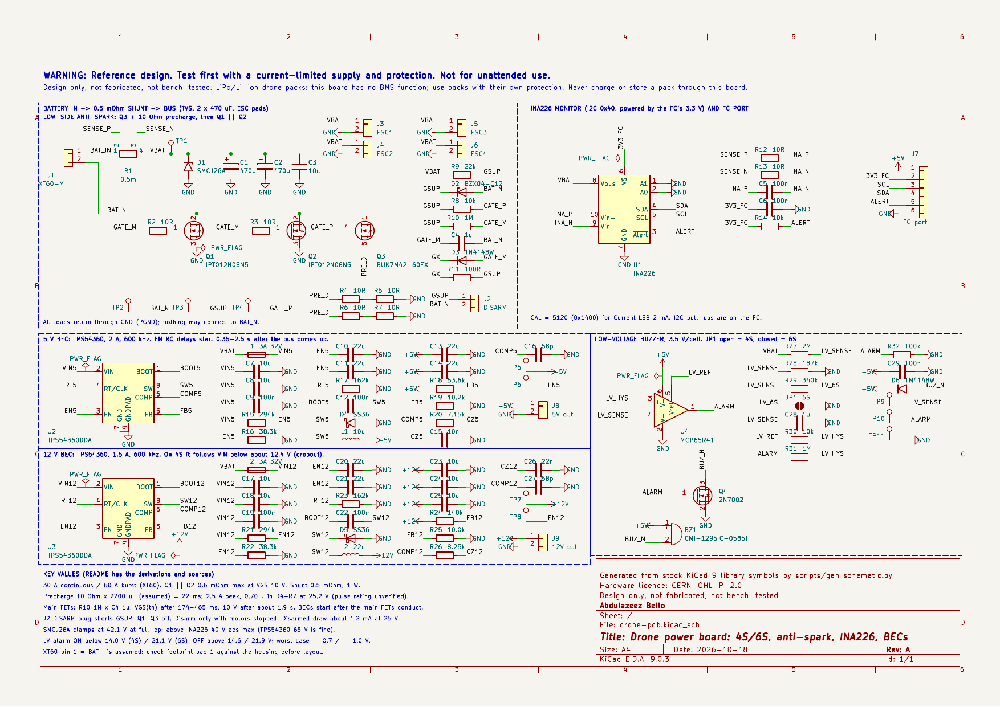
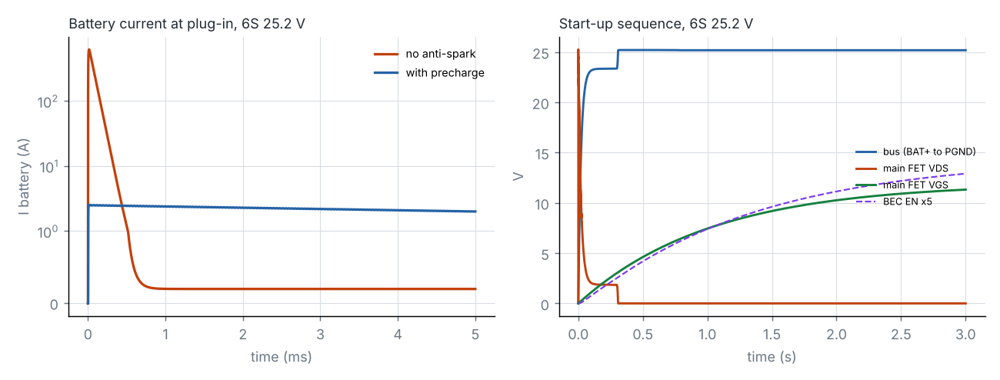
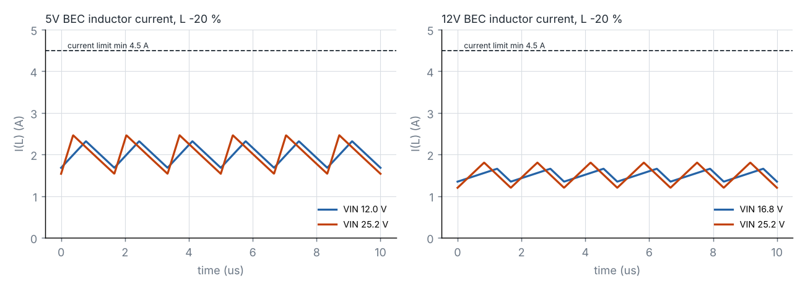

# Drone power board: 4S/6S, anti-spark, INA226, 5 V and 12 V BECs

Open-source KiCad reference design by **Abdulazeez Bello**, embedded systems engineer.

> **WARNING — Reference design. Test first with a current-limited supply and protection. Not for unattended use.**
> This board switches the full current of a 4S or 6S LiPo/Li-ion drone pack. It has **no BMS function**: no cell balancing, no over-discharge cut-off and no main fuse. Use packs that have their own protection, never charge or store a pack through this board, and keep a fuse or a current-limited supply in the battery lead until the board has passed the bench steps in §6. Nothing here is certified, and nothing here claims compliance with any safety standard.

**Status: Design only, not fabricated, not bench-tested.**

Schematic generated with AI assistance at my direction; I reviewed pin assignments against the datasheets.



| | |
|---|---|
| Schematic (PDF) | [`docs/drone-pdb-schematic.pdf`](docs/drone-pdb-schematic.pdf) |
| KiCad project (KiCad 9) | [`hardware/`](hardware/) |
| Bill of materials | [`docs/drone-pdb-bom.csv`](docs/drone-pdb-bom.csv) |
| ERC report | [`docs/erc.rpt`](docs/erc.rpt) (0 errors, 0 warnings) |
| Calculator | [`scripts/pdb_calc.py`](scripts/pdb_calc.py), output in [`docs/calc-output.txt`](docs/calc-output.txt) |
| Simulation | [`scripts/run_sims.py`](scripts/run_sims.py), results in [`sim/results.txt`](sim/results.txt) |
| Netlist check | [`scripts/verify_netlist.py`](scripts/verify_netlist.py) (PASS) |

---

## 1. What it does

The board takes a 4S (12.0–16.8 V) or 6S (18.0–25.2 V) pack on an XT60 and gives you:

- **Four ESC pad pairs** on the battery bus. The bus is rated **30 A continuous and 60 A burst**, which is the XT60's rating.
- A **low-side anti-spark switch.** At plug-in, the bus capacitors charge through a 10 Ω precharge resistor. After about 0.2–0.5 s, two 1.2 mΩ MOSFETs close. A small JST-GH plug (J2, "DISARM") holds everything off while it is inserted, like a remove-before-flight tag.
- **Battery current and voltage on I²C** from a TI INA226 measuring a 0.5 mΩ Kelvin shunt. The INA226 runs from the flight controller's 3.3 V.
- **A 5 V / 2 A BEC and a 12 V / 1.5 A BEC**, each a TI TPS54360 (60 V buck, 600 kHz). They start about 0.35–2.5 s after the bus comes up, so their load never lands on the precharge resistor.
- **A low-voltage buzzer** at 3.5 V/cell that works without the flight controller. It uses a Microchip MCP65R41 comparator with a built-in 1.21 V reference. Solder jumper JP1 selects 4S or 6S.

```
XT60+ ─ R1 0.5 mΩ ─┬─ VBAT bus ─ D1 SMCJ26A, C1/C2 470 µF, C3 ─ ESC1..4 (+)
         (INA226)  ├─ F1 ─ U2 TPS54360 ─ +5 V (2 A)  ─ FC port, buzzer, J8
                   ├─ F2 ─ U3 TPS54360 ─ +12 V (1.5 A) ─ J9
                   └─ R27/R28 divider ─ U4 MCP65R41 ─ Q4 ─ BZ1
ESC1..4 (−), all GND returns ═ PGND (GND) ─ Q1 ∥ Q2 (main) ─┬─ BAT_N ─ XT60−
                                           Q3 + R4..R7 (precharge) ┘
Gate supply: VBAT ─ R9 22k ─ GSUP (12 V zener D2 to BAT_N); J2 DISARM shorts GSUP to BAT_N
GSUP ─ R8 ─ Q3 gate (fast);  GSUP ─ R10 1M / C4 1µ ─ Q1/Q2 gates (slow; D3 + R11 discharge fast)
```

**Important:** the board's GND (PGND) is *not* battery negative. PGND is connected to BAT_N through the switch. Every load (ESCs, flight controller, VTX, camera) must return through PGND. A wire from any load straight to the battery's negative lead bypasses the switch and the precharge.

## 2. Requirements

| # | Requirement (from the brief) | How it is met |
|---|---|---|
| R1 | 4S/6S input | Every part on the bus is rated above the TVS clamp, 42.1 V (§3.6), except the INA226 inputs (§7) |
| R2 | XT60 | J1 AMASS XT60-M: 30 A continuous, 60 A burst, 0.55 mΩ contact (AMASS datasheet V1.2) |
| R3 | Precharge | Q3 + 10 Ω (R4–R7, 2S2P) charges the bus before Q1/Q2 close (§3.3, §5) |
| R4 | 5 V BEC | U2 TPS54360, 2 A (§3.7) |
| R5 | 12 V BEC | U3 TPS54360, 1.5 A. It drops out on 4S below about 12.4 V (§3.7) |
| R6 | INA226 current sense | U1, 0.5 mΩ Kelvin shunt, CAL = 5120 for 2 mA/LSB (§3.2) |
| R7 | Low-voltage buzzer | U4 + Q4 + BZ1, 3.5 V/cell, 4S/6S jumper (§3.8) |
| R8 | Nothing from AirChain | Generic topology, parts and net names |

## 3. Design calculations

The numbers come from `python3 scripts/pdb_calc.py`; its full output is in `docs/calc-output.txt`. Values marked **[ASSUMPTION]** are not from a datasheet. Datasheet sources are listed in §10.

### 3.1 Main current path

- **Rating:** the XT60 is rated 30 A continuous and 60 A instantaneous, so the board is designed to 30 A / 60 A.
- **Main switch (Q1 ∥ Q2, Infineon IPT012N08N5):** each FET is 1.2 mΩ max at VGS = 10 V (1.7 mΩ at 6 V). The pair is 0.6 mΩ.
  - At 30 A: 0.54 W at the 25 °C maximum, or **0.92 W** with an assumed ×1.7 hot multiplier **[ASSUMPTION: RDS(on)-vs-temperature curve not read]**. That is 0.46 W per FET, or **+18 K** at RthJA 40 K/W (6 cm² copper).
  - At a 60 A burst: 1.84 W per FET. That would be +73 K if sustained, so bursts must stay short.
- **Shunt (R1, Vishay WSK2512, 0.5 mΩ, 1 %, 1 W at 70 °C):** 0.45 W at 30 A. At 60 A it is **1.8 W, above its 1 W rating**, which is acceptable only for short bursts. The datasheet does not give a short-time overload figure, so this is unverified.
- **Path resistance:** the XT60 (2 × 0.55 mΩ), shunt and FETs add up to 2.2 mΩ, a 66 mV drop at 30 A before PCB copper.

### 3.2 INA226 current sense

- **Full scale:** 81.92 mV / 0.5 mΩ = 163.8 A. One shunt-register LSB (2.5 µV) is 5 mA.
- **Calibration:** with Current_LSB = 2 mA, **CAL = 0.00512 / (2 mA × 0.5 mΩ) = 5120 (0x1400)**. The current register then tops out at 65.5 A, and the power LSB is 50 mW.
- **Error:**
  - Offset: 10 µV max = 20 mA.
  - Gain: 0.1 % (INA226) + 1 % (shunt) + 350 ppm/K TCR × 50 K self-heating **[ASSUMPTION]** = 1.75 %.
  - Total: about ±0.9 A at 30 A.
- **Input filter:** R12/R13 10 Ω with C5 100 nF differential, within the datasheet's recommendation (≤ 10 Ω, 0.1–1 µF).
- **Wiring and supply:**
  - VBUS (pin 8) reads the bus with respect to PGND.
  - A0 and A1 are tied to GND, which gives address **0x40**.
  - The INA226 is powered from the FC port's **3.3 V**, because its SDA/SCL VIH is 0.7 × VS. On 5 V it would not reliably read 3.3 V logic.
  - Its datasheet allows the bus voltage to be present while VS is off, so the inputs are safe before the FC powers up.

### 3.3 Precharge

| Quantity | Value |
|---|---|
| R_PRE | 2S2P of 10 Ω CRGP2512 = **10 Ω** |
| C_LOAD | 2 × 470 µF on board + ~4 × 330 µF in the ESCs ≈ **2200 µF [ASSUMPTION]** |
| τ, 99 % | 22 ms, 101 ms |
| Peak at 25.2 V | 2.52 A, 63.5 W (15.9 W per resistor) |
| Energy | ½CV² = **0.70 J** (0.175 J per resistor) |
| Residual when Q1/Q2 close | ESC idle current 0.2 A **[ASSUMPTION]** × 10 Ω = 2 V |

The TE CRGP2512 is a 2 W pulse-withstanding thick-film part, but its datasheet gives the pulse capability **only as a graph**. The 0.175 J per resistor in about 22 ms has **not been checked against it**. The bench plan (§6) includes a before-and-after resistance check.

### 3.4 Gate supply and main-switch delay

- **Gate supply GSUP:** R9 22 kΩ from VBAT, clamped by a BZX84-C12 zener (11.4–12.7 V at 5 mA) to BAT_N.
  - The zener carries 0.63 mA at most (6S full). At that current it sits a little below its 5 mA voltage **[ASSUMPTION]**.
  - On 4S near empty, the zener does not conduct and GSUP follows VBAT (≥ 12 V).
- **Q3 (precharge):** its gate is fed through R8 10 kΩ, so it turns on immediately.
- **Q1/Q2 (main):** their gates are fed through R10 1 MΩ into C4 1 µF. The gate charge of 2 × 178 nC adds about 3.6 % to C4.

| Case | τ | VGS reaches VGS(th) | VGS reaches 10 V |
|---|---|---|---|
| Nominal (VTH 3.0 V, VZ 12.0 V) | 1.04 s | 298 ms | 1.86 s |
| Earliest (VTH 2.2 V, VZ 12.7 V, C4 −10 %) | 0.92 s | **174 ms** | 1.42 s |
| Latest (VTH 3.8 V, VZ 11.4 V, C4 +10 %) | 1.15 s | **465 ms** | 2.41 s |

- **Precharge comes first:** it reaches 99 % at 101 ms, before the earliest VGS(th) crossing at 174 ms.
- **Arming:** arm the motors only after about **3 s**. Before then, Q1/Q2 are not fully enhanced.
- **DISARM:** J2 shorts GSUP to BAT_N. C4 then discharges through D3 + R11 100 Ω (τ = 0.1 ms, peak 127 mA vs the 1N4148W's 500 mA IFSM).
  - Turning off under load would take the FETs through their linear region and dump the lead inductance energy into them. **Disarm only with the motors stopped** (§7).
- **Standby drain:** disarmed but plugged in, R9 draws **1.15 mA at 25.2 V (≈ 27 mAh/day)**. Disarmed is not off; unplug the pack for storage.

### 3.5 Why the BECs wait

If a BEC started during precharge, its load (≈ 32 W combined) would flow through the 10 Ω resistor. The bus would then never finish charging.

- **EN network:** each TPS54360 EN pin has a 294 k / 38.3 k divider (UVLO: start 10.06 V, stop 9.06 V nominal) and 2 × 22 µF on EN.

| Bus voltage | EN settles at | BEC starts after |
|---|---|---|
| 12.0 V (4S empty) | 1.42 V | 2.48 s |
| 16.8 V (4S full) | 1.98 V | 1.25 s |
| 25.2 V (6S full) | 2.95 V | **0.70 s (0.63 s with C −10 %)** |

- **Ordering:** the earliest BEC start (0.63 s) is later than the latest main-FET VGS(th) crossing (0.47 s). The simulation (§5) shows VGS of 6.3–8.7 V and VDS ≈ 1 mV when the BECs start.
- **Tolerances:**
  - The UVLO thresholds spread from 9.19–10.93 V (start) to 7.87–10.28 V (stop), using the datasheet's EN threshold (1.1–1.3 V) and hysteresis current (2.2–4.5 µA).
  - The 1.2 µA pull-up is a typical value only.
  - The capacitor's DC-bias derating (×0.9) is an **[ASSUMPTION]**.

### 3.6 Transient clamp

D1 SMCJ26A (Littelfuse) has VR = 26 V (above 25.2 V), VBR = 28.9–31.9 V at 1 mA, and **VC = 42.1 V at 35.7 A**.

| Part on the bus | Limit | At 42.1 V |
|---|---|---|
| TPS54360 VIN | 65 V abs max | OK |
| IPT012N08N5 / BUK7M42-60E VDS | 80 V / 60 V | OK |
| Panasonic FR bulk, MLCCs | 50 V | OK |
| **INA226 IN+/IN−/VBUS** | **40 V abs max** (36 V operating) | **Exceeded at full Ipp** |
| Littelfuse 466 fuses | 32 V rating | Fine at 25.2 V; the rating does not cover interrupting during a clamp event |

The bulk capacitors absorb ordinary lead-inductance spikes long before the TVS reaches full Ipp, but that has not been measured. §7 lists the INA226 conflict.

### 3.7 BECs (TPS54360, 600 kHz)

**Settings common to both BECs:**

- RT = 162 kΩ gives 600 kHz (the datasheet's design-example value; Eq. 7 gives 597 kHz).
- The minimum on-time is 135 ns typ. At the TVS clamp, the 5 V BEC's on-time is 198 ns, which is still above it.

**Per-rail values:**

| | 5 V BEC (U2) | 12 V BEC (U3) |
|---|---|---|
| Load | 2.0 A | 1.5 A |
| FB divider | 53.6k / 10.2k → 5.004 V (4.85–5.16 V) | 140k / 10.0k → 12.00 V (11.64–12.36 V) |
| L(min), Eq. 28 at KIND 0.3, 25.2 V | 11.1 µH → **XAL6060-103** (10 µH, Isat 7.6 A) | 23.3 µH → **XAL6060-223** (22 µH, Isat 5.6 A) |
| Ripple / peak at 25.2 V, L −20 % | 0.83 A / 2.42 A | 0.60 A / 1.80 A |
| Cout | 2 × 22 µF 16 V → 30.8 µF effective **[ASSUMPTION]** | 3 × 10 µF 50 V → 22.5 µF effective **[ASSUMPTION]** |
| Compensation (Eq. 44–51) | fco 24.9 kHz: R20 7.15k, C15 10 nF, C16 68 pF | fco 16.3 kHz: R26 8.25k, C26 22 nF, C27 68 pF |
| SS36 catch-diode loss (VF 0.75 V bound) | **≤ 1.20 W** at 25.2 V | ≤ 0.59 W |
| Input fuse | F1 0466003 (3 A; derated 1.8 A at 70 °C) | F2 0466003 |

**Diode heat:** SS36 RθJA is 55 °C/W, so 1.2 W would be a 66 K rise. The 0.75 V figure is the datasheet maximum at 3 A; at 1.6 A the drop is lower, but that is read only from a curve. The diode is the hottest part of the 5 V BEC.

**12 V dropout on 4S:**

- The TPS54360 datasheet gives no maximum duty cycle, only that it "can approach 100 %" while BOOT stays charged.
- Assuming near-100 % duty, VIN must be ≥ 12 + 1.5 × (0.19 + 0.061) ≈ **12.4 V**, which is 3.1 V/cell on 4S.
- Below that, the 12 V rail follows the pack down. On 6S it always regulates.

**Inductor saturation:** the TPS54360 current limit is 4.5–6.8 A. XAL6060-223's Isat (5.6 A, 30 % drop) sits inside that range, so in a hard short L2 may saturate before the limit acts. The datasheet's own design example uses an inductor with Isat below the maximum limit.

### 3.8 Low-voltage alarm

The divider is R27 2.00 MΩ over R28 187 kΩ; closing JP1 adds R29 340 kΩ for 6S. The divider drives VIN−, and VREF drives VIN+ through R30 10 kΩ, with R31 1 MΩ from OUT for hysteresis.

| | Alarm ON below | Worst case (VREF ±2 %, VOS ±10 mV, R 1 %) | Alarm OFF above |
|---|---|---|---|
| 4S (JP1 open) | 14.01 V (3.50 V/cell) | 13.36–14.67 V | 14.59 V (3.65 V/cell) |
| 6S (JP1 closed) | 21.06 V (3.51 V/cell) | 20.07–22.06 V | 21.93 V (3.65 V/cell) |

- **Filter:** C28 1 µF gives τ = 171 ms (4S) or 114 ms (6S), which rides through brief sag. A hard punch-out on a tired pack will still chirp. For a precise alarm, use the INA226 reading in firmware; this circuit is the backup that works without it.
- **Before the 5 V BEC starts:** the divider feeds the comparator input while VDD is 0 V. The current is limited by 2 MΩ to 12.4 µA, against the 2 mA abs-max input current.
- **VREF:** the load is 1.2 µA. There is no capacitor on VREF, because the datasheet warns that more than 2000 pF can make it oscillate.
- **Buzzer:** the CMI-1295IC-0585T draws 30 mA. Through the 2N7002 (5.3 Ω max at 4.5 V), it sees 4.84 V, inside its 4–7 V range.

## 4. Decisions and trade-offs

| Decision | Why | What it costs |
|---|---|---|
| Low-side N-MOSFET switch | 1.2 mΩ N-FETs driven straight from the pack through a zener; no charge pump or driver IC | Board GND is not battery negative. Every load must return through PGND, and USB-connected equipment on the FC sees a floating ground while disarmed |
| Resistor precharge, then a delayed main switch | Peak current is set by R_PRE (2.5 A), not by unknown ESC capacitance; the main FETs close with about 1 V across them | Extra FET and four resistors; full enhancement takes about 2 s; resistor pulse rating unverified |
| 2 × IPT012N08N5 (80 V, TOLL) | Clear datasheet pinout (gate pin 1, source pins 2–8, drain tab) that matches the KiCad symbol and footprint | Large packages. The Vishay SQJQ160EL (0.8 mΩ) was rejected: the KiCad symbol puts the gate on pin 1, and the Vishay datasheet text could not confirm that (its pin labels read either way) |
| DISARM plug shorts the gate supply | Fails safe while the plug is in, fast turn-off, no switch rated for 60 A | Removing the plug arms the board. Disarming under load is not allowed, and it draws 1.15 mA while disarmed |
| High-side 0.5 mΩ Kelvin shunt + INA226 | Inside the INA226 common-mode range, 0.45 W at 30 A, standard I²C part the brief asked for | 40 V abs max is below the TVS clamp; the shunt exceeds 1 W at 60 A bursts |
| INA226 on the FC's 3.3 V | Logic levels match the FC | No current reading unless the FC powers the port |
| TPS54360 for both BECs | 65 V abs max (above the 42 V clamp), stock symbol, one part number | Asynchronous: up to 1.2 W in the 5 V catch diode; the 12 V rail drops out on 4S |
| EN RC start delay | Keeps BEC load off the precharge resistor without extra logic | BECs come up 0.35–2.5 s after plug-in; 4 × 22 µF |
| SMCJ26A on the bus | Lowest standoff above 25.2 V | Clamp of 42.1 V exceeds the INA226 rating |
| Comparator + reference for the alarm | Works without firmware | ±0.7 V (4S) / ±1.0 V (6S) threshold spread; chirps on heavy sag |
| Solder pads for ESCs and BEC outputs | Vibration-proof, usual for drone boards | No connector MPN; wire gauge is up to the builder |
| No main fuse | No fuse in the 1206/SMD range carries 60 A bursts; drone practice relies on the pack and ESCs | A shorted ESC is limited only by the pack. Test with a fuse in the lead |

## 5. Verification done

| Check | Result |
|---|---|
| `kicad-cli sch erc --severity-all` (KiCad 9.0.3) | **0 errors, 0 warnings** |
| Netlist vs design intent (`verify_netlist.py`, 41 named + 4 anonymous nets) | **PASS** |
| Footprints exist in the KiCad 9 libraries | All 25 found |
| ngspice 44.2, plug-in with anti-spark at 25.2 V | Peak battery current **2.52 A**; R_PRE peak 63 W, 0.83 J (includes ESC idle current); main FETs conduct at 0.30 s with 1.33 V across them; peak FET dissipation 0.70 W, 7.5 mJ total; BECs start at 0.76 s with VGS 6.3 V |
| ngspice, plug-in with anti-spark at 16.8 V | Peak 1.67 A; BECs start at 1.35 s with VGS 8.7 V |
| ngspice, plug-in **without** anti-spark | **619 A** peak at 25.2 V, 413 A at 16.8 V. Limited only by the assumed 15 mΩ pack, 20 mΩ ESR and 150 nH leads; this is the spark |
| ngspice, BEC power stages (open loop, L −20 %) | 5 V: ripple 0.64 / 0.93 A, peak 2.32 / 2.46 A, output ripple 4.4 / 6.4 mV p-p at 12 / 25.2 V. 12 V: ripple 0.31 / 0.61 A, peak 1.66 / 1.80 A, 2.9 / 5.9 mV p-p at 16.8 / 25.2 V. All peaks are below the 4.5 A current-limit minimum |




**What the simulations do not cover:**

- They use level-1 MOSFET models fitted to RDS(on) max and typical VGS(th), behavioural diodes, and an ideal high-side switch at 190 mΩ. Every assumption is listed in `sim/models.lib` and `scripts/run_sims.py`.
- They do **not** model the TPS54360 control loop, soft-start or current limit, MOSFET SOA or avalanche, contact arcing, real ESC input stages, or the comparator.
- The plug-in numbers depend on the assumed pack resistance, lead inductance and ESC capacitance.

### Pin-by-pin check

Each row was compared with the manufacturer's pin table and with the exported netlist.

| Ref | Part | Pin → net | Datasheet source | Result |
|---|---|---|---|---|
| U1 | INA226AIDGSR (VSSOP-10) | 1 A1→GND, 2 A0→GND, 3 ALERT→ALERT, 4 SDA, 5 SCL, 6 VS→3V3_FC, 7 GND, 8 VBUS→VBAT, 9 IN−→INA_N, 10 IN+→INA_P | TI INA226 pin table (DGS) | ✓ |
| U2, U3 | TPS54360DDAR (SO PowerPAD-8) | 1 BOOT, 2 VIN, 3 EN, 4 RT/CLK, 5 FB, 6 COMP, 7 GND, 9 PowerPAD→GND, 8 SW | TI TPS54360 §5 (DDA) | ✓ |
| U4 | MCP65R41T-1202E/CHY (SOT-23-6) | 1 OUT→ALARM, 2 VSS→GND, 3 VIN+→LV_HYS, 4 VIN−→LV_SENSE, 5 VREF→LV_REF, 6 VDD→+5V | Microchip DS22269A pin table | ✓ |
| Q1, Q2 | IPT012N08N5 (PG-HSOF-8) | 1 G→gate stopper, 2 (pins 2–8) S→BAT_N, 3 (tab) D→GND | Infineon cover page "Gate Pin 1, Source Pin 2-8, Drain Tab"; KiCad footprint pad 1 = corner pin, pad 2 = source pins, pad 3 = tab | ✓ |
| Q3 | BUK7M42-60EX (LFPAK33) | 1,2,3 S→BAT_N, 4 G→GATE_P, 5 (mb) D→PRE_D | Nexperia Table 2 | ✓ |
| Q4 | 2N7002,215 (SOT-23) | 1 G→ALARM, 2 S→GND, 3 D→BUZ_N | NXP/Nexperia Table 2 | ✓ |
| D1 | SMCJ26A | 1 K→VBAT, 2 A→GND | Littelfuse: cathode band on the positive end | ✓ |
| D2 | BZX84-C12,215 | 3 K→GSUP, 1 A→BAT_N, 2 n.c. | Nexperia BZX84 pinning (checked for the 5 V bus design) | ✓ |
| D3, D6 | 1N4148W-V-GS08 | D3: 1 K→GX, 2 A→GATE_M. D6: 1 K→+5V, 2 A→BUZ_N | Vishay 85748, cathode bar | ✓ |
| D4, D5 | SS36-E3/57T | 1 K→SW5/SW12, 2 A→GND | Vishay 88751; **package SMC, KiCad default D_SMA overridden** | ✓ |
| R1 | WSK2512 0.5 mΩ | 1 I→BAT_IN, 4 I→VBAT, 2 E→SENSE_P, 3 E→SENSE_N | Vishay: I1/I2 current, E1/E2 sense. Footprint pads 1/4 large, 2/3 small, with 2 on pad 1's side | ✓ |
| C1, C2 | EEU-FR1H471 | 1 (+)→VBAT, 2→GND | Polarised symbol | ✓ |
| J1 | AMASS XT60-M | 1→BAT_IN (+), 2→BAT_N (−) | **AMASS datasheet does not number the pins** | **Unverified**: check pad 1 against the housing's + mark |
| BZ1 | CMI-1295IC-0585T | 1 (+)→+5V, 2→BUZ_N | Footprint pad 1 has "+" silk. **The datasheet's pin pitch and polarity drawing were not readable** | **Unverified** |
| J7 | SM06B-GHS-TB | 1 +5V, 2 3V3_FC, 3 SCL, 4 SDA, 5 ALERT, 6 GND | This board's own pin order, not a flight-controller standard. Make the cable to suit | n/a |

## 6. How to test on the bench

Work in this order, and do not skip to a battery. **Start every step with a current-limited bench supply.**

1. **Before any power.**
   - Measure VBAT–GND, VBAT–BAT_N, +5V–GND and +12V–GND. None should be a short.
   - With J2 open, BAT_N–GND should read high resistance.
   - Measure R4–R7 and record the values.
2. **Disarmed.**
   - Insert the J2 DISARM plug, set the supply to 12.0 V with a **50 mA** limit, and connect it to the XT60.
   - The current should be about 0.55 mA (R9). TP3 GSUP should read about 0 V and TP4 GATE_M 0 V.
3. **Arm, no load.**
   - Raise the limit to 300 mA, put a scope on TP4 (GATE_M vs TP2 BAT_N) and on GND vs BAT_N, then pull J2.
   - Expected:
     - GND–BAT_N collapses within about 0.1 s.
     - GATE_M rises with τ ≈ 1 s toward about 12 V.
     - TP6 EN5 crosses 1.2 V after about 2.5 s at 12 V.
   - Then +5V and +12V come up. At a 12 V input the 12 V rail sits just below the input (dropout).
4. **Input sweep.**
   - Step the supply through 14.8, 16.8, 22.2 and 25.2 V.
   - Check +5V (4.85–5.16 V) and +12V (11.64–12.36 V once VIN > 12.4 V).
   - Watch SW5/SW12 on a scope for clean 600 kHz switching.
5. **BEC load.**
   - Use an electronic load: 2 A on J8 and 1.5 A on J9 at 25.2 V.
   - Check the output ripple, and the temperature of D4/D5 and U2/U3. D4 should be the hottest part.
6. **Low-voltage alarm.**
   - With JP1 open, sweep the supply down from 16.8 V. The buzzer should start at about 14.0 V and stop above about 14.6 V.
   - Close JP1 and repeat from 25.2 V: about 21.1 V on, 21.9 V off.
7. **INA226.**
   - Power J7 pin 2 from 3.3 V and use an I²C adapter at address 0x40.
   - Write CAL = 0x1400, then read the bus voltage.
   - Load the ESC pads from a supply that can deliver it, in steps of 1, 5 and 10 A, and compare the reading with a reference meter.
8. **Main path.**
   - Use a supply or a fused pack with a 30 A-capable load on the ESC pads.
   - Go up in steps (5, 10, 20, 30 A) at 16.8 V. Measure GND–BAT_N (≤ 18 mV expected at 30 A from RDS(on) max) and the Q1/Q2, R1 and XT60 temperatures.
9. **Precharge endurance.**
   - Add capacitance on the ESC pads up to about 2200 µF total.
   - Plug and unplug 20 times at 25.2 V with the supply limit set to 5 A, then re-measure R4–R7.
   - Any change of more than 1 % means the pulse rating is exceeded.
10. **Disarm.** Test it only at no load.
11. **Real pack.** Use one only after steps 1–10 pass, with an inline fuse, on a non-flammable surface, attended.

## 7. Known limitations

- **INA226 vs TVS clamp:**
  - At full SMCJ26A Ipp the bus reaches 42.1 V, above the INA226's 40 V abs max.
  - The datasheet's own guidance is not to exceed 36 V on the inputs.
  - 6S full (25.2 V) is fine; transients are the risk. An 85 V monitor (for example the INA228) would remove this conflict but was not part of the brief.
- **Disarming under load is not supported:**
  - C4 discharges with τ = 0.1 ms, so the FETs spend roughly 50 µs crossing their threshold region while carrying the load. At 30 A and 25 V that is on the order of tens of millijoules.
  - The battery-lead energy adds ½LI² ≈ 0.07 mJ (150 nH **[ASSUMPTION]**). Both are far below EAS = 817 mJ.
  - The linear-mode SOA was **not checked**, because Infineon gives it only as a graph.
- **Precharge resistor pulse rating unverified:** the TE datasheet gives a graph only.
- **Ground:**
  - PGND floats when the board is disarmed.
  - Do not ground the FC through USB while a pack is connected and the board is disarmed.
  - Never connect a load to BAT_N.
- **Thermal limits:**
  - The 5 V BEC's SS36 can dissipate up to 1.2 W on 6S, so derate it, or use a synchronous buck in a later revision.
  - The shunt (1 W) and the FETs are sized for 30 A continuous. 60 A is a burst figure only.
- **The 12 V BEC drops out on 4S** below about 12.4 V (3.1 V/cell).
- **No BMS function:** the board has no cell monitoring, no over-discharge cut-off and no main overcurrent protection. The alarm only beeps.
- **The low-voltage alarm is coarse:** ±0.7 V (4S) / ±1.0 V (6S) worst case, and it chirps on sag. Use the INA226 reading in firmware for anything that matters.
- **Unverified pinouts:** the XT60 pad 1 polarity and the buzzer polarity/pitch need checking before layout.
- **Connector naming:** AMASS's datasheet recommends XT60-F on the battery and XT60-M on the controller. KiCad describes the XT60-M footprint as "female". Check the mating half physically.
- **No layout.** Current paths, copper area for Q1/Q2/R1, Kelvin routing of the shunt and the BEC hot loops all decide whether the numbers above hold.

## 8. Bill of materials

Full CSV: [`docs/drone-pdb-bom.csv`](docs/drone-pdb-bom.csv). **MPN check:**

- Datasheet-checked in this design or a previous one: the ICs, FETs, diodes, R1, R4–R7, the inductors, the fuses, C1/C2 and the Murata parts GRM32ER71H106KA12L, GRM32ER71C226KE18L, GRM188R71H104KA93D and GRM21BR71H105KA12L.
- Built from manufacturer naming rules but **not individually checked** against a datasheet:
  - GRM188R71H103KA01D, GRM188R71H223KA01D, GRM1885C1H680JA01D.
  - The Yageo RC0603 codes not used in earlier designs.
  - WSK25120L500FEA, which follows Vishay's stated "L" rule.

| Refs | Qty | Value | Part (MPN) | Manufacturer |
|---|---|---|---|---|
| U1 | 1 | INA226 | INA226AIDGSR | Texas Instruments |
| U2, U3 | 2 | TPS54360DDA | TPS54360DDAR | Texas Instruments |
| U4 | 1 | MCP65R41 | MCP65R41T-1202E/CHY | Microchip |
| Q1, Q2 | 2 | 80 V 1.2 mΩ | IPT012N08N5ATMA1 | Infineon |
| Q3 | 1 | 60 V 42 mΩ | BUK7M42-60EX | Nexperia |
| Q4 | 1 | 60 V | 2N7002,215 | Nexperia |
| D1 | 1 | TVS 26 V | SMCJ26A | Littelfuse |
| D2 | 1 | 12 V zener | BZX84-C12,215 | Nexperia |
| D3, D6 | 2 | 1N4148W | 1N4148W-V-GS08 | Vishay |
| D4, D5 | 2 | 60 V 3 A Schottky | SS36-E3/57T | Vishay |
| R1 | 1 | 0.5 mΩ 1 W | WSK25120L500FEA | Vishay Dale |
| R4–R7 | 4 | 10 Ω 2 W pulse | CRGP2512F10R | TE Connectivity |
| L1 | 1 | 10 µH | XAL6060-103MEC | Coilcraft |
| L2 | 1 | 22 µH | XAL6060-223MEC | Coilcraft |
| F1, F2 | 2 | 3 A 32 V | 0466003.NRHF | Littelfuse |
| C1, C2 | 2 | 470 µF 50 V | EEU-FR1H471 | Panasonic |
| C3, C7, C8, C17, C18, C23–C25 | 8 | 10 µF 50 V X7R 1210 | GRM32ER71H106KA12L | Murata |
| C10, C11, C13, C14, C20, C21 | 6 | 22 µF 16 V X7R 1210 | GRM32ER71C226KE18L | Murata |
| C4, C28 | 2 | 1 µF 50 V X7R 0805 | GRM21BR71H105KA12L | Murata |
| C5, C6, C9, C12, C19, C22, C29 | 7 | 100 nF 50 V X7R 0603 | GRM188R71H104KA93D | Murata |
| C15 / C26 | 1 / 1 | 10 nF / 22 nF 50 V X7R | GRM188R71H103KA01D / GRM188R71H223KA01D | Murata |
| C16, C27 | 2 | 68 pF 50 V C0G | GRM1885C1H680JA01D | Murata |
| R2, R3, R8–R32 | — | 0603 1 % | RC0603FR-07xxxL (see CSV) | Yageo |
| J1 | 1 | XT60 | XT60-M | AMASS |
| J2 / J7 | 1 / 1 | JST-GH 2 / 6 pin | SM02B-GHS-TB(LF)(SN) / SM06B-GHS-TB(LF)(SN) | JST |
| BZ1 | 1 | 5 V self-drive buzzer | CMI-1295IC-0585T | Same Sky |
| TP1, TP3–TP10 / TP2, TP11 | 9 / 2 | Test point red / black | 5000 / 5001 | Keystone |
| J3–J6, J8, J9, JP1 | — | Solder pads / jumper | PCB features, no part | — |

## 9. Open assumptions

1. C_LOAD of 2200 µF, ESC idle current of 0.2 A, pack resistance of 15 mΩ and lead inductance of 150 nH. These set the precharge timing and the simulation results.
2. RDS(on) multiplier ×1.7 at a hot junction.
3. MLCC DC-bias retention (×0.7 for 22 µF/16 V at 5 V, ×0.75 for 10 µF/50 V at 12 V, ×0.9 for the EN capacitors).
4. Zener voltage at 0.1–0.6 mA.
5. Near-100 % duty for the 12 V dropout estimate.
6. Shunt self-heating of 50 K in the INA226 error budget.
7. BEC efficiency of 0.88 for input-current estimates.

## 10. Datasheets used

TI INA226 · TI TPS54360 · Microchip MCP65R41/6R46 (DS22269A) · Infineon IPT012N08N5 (v2.1) · Nexperia BUK7M42-60E · NXP/Nexperia 2N7002 (rev 7) · Nexperia BZX84 series · Vishay 1N4148W (85748) · Vishay SS32–SS36 (88751) · Littelfuse SMCJ series · Littelfuse 466 series · Vishay WSK2512 · TE CRGP series · Coilcraft XAL60xx · Panasonic FR series · AMASS XT60 (V1.2) · JST GH (eGH) · Same Sky CMI-1295IC-0585T. The URLs are in each symbol's Datasheet field and in `scripts/gen_schematic.py`.

## 11. Rebuild

```sh
KICAD_CLI=kicad-cli SYMDIR=/usr/share/kicad/symbols sh scripts/build.sh   # schematic, ERC, netlist check, PDF, BOM
python3 scripts/pdb_calc.py                                                # calculations
NGSPICE=ngspice python3 scripts/run_sims.py                                # simulations (writes ~300 MB of waveforms to sim/, git-ignored)
```

## 12. Licence

- Scripts (`scripts/`): MIT, see `LICENSE-MIT.txt`.
- Hardware (schematic, project, BOM, `sim/models.lib`): CERN-OHL-P-2.0, see `LICENSE-CERN-OHL-P-2.0.txt`.
