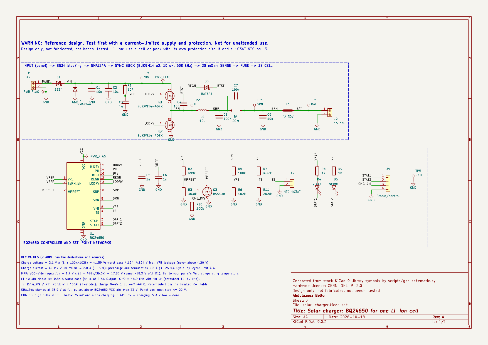
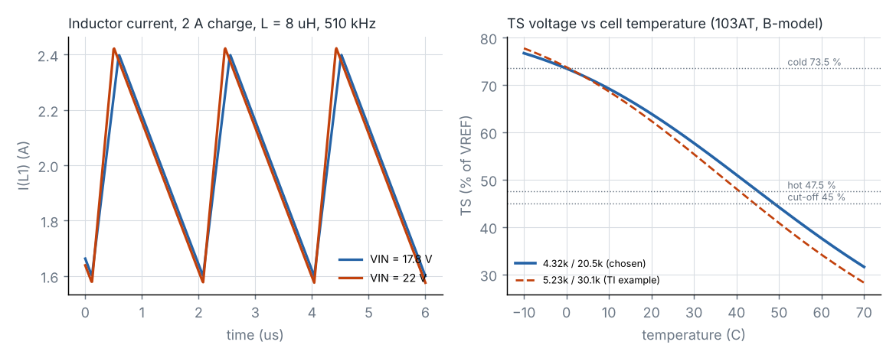

# Solar charger: BQ24650 for one Li-ion cell

Open-source KiCad reference design by **Abdulazeez Bello**, embedded systems engineer.

> **WARNING — Reference design. Test first with a current-limited supply and protection. Not for unattended use.**
> This board charges a Li-ion cell. Use a cell or pack that has **its own protection circuit**, and fit a 103AT NTC thermistor in thermal contact with the cell (J3). Nothing here is certified or claims compliance with any safety standard.

**Status: Design only, not fabricated, not bench-tested.**

Schematic generated with AI assistance at my direction; I reviewed pin assignments against the datasheets.



| | |
|---|---|
| Schematic (PDF) | [`docs/solar-charger-schematic.pdf`](docs/solar-charger-schematic.pdf) |
| KiCad project (KiCad 9) | [`hardware/`](hardware/) |
| Bill of materials | [`docs/solar-charger-bom.csv`](docs/solar-charger-bom.csv) |
| ERC report | [`docs/erc.rpt`](docs/erc.rpt) |
| Calculator | [`scripts/charger_calc.py`](scripts/charger_calc.py), output in [`docs/charger_calc_output.md`](docs/charger_calc_output.md) |
| Simulation | [`scripts/run_sims.py`](scripts/run_sims.py), results in [`sim/results.txt`](sim/results.txt) |

---

## 1. What it does

It charges one Li-ion cell from a 12 V-class solar panel (36 cells, Voc ≤ 22 V, Vmp ≈ 18 V) at up to **2 A**. Charging runs in the usual order: precharge, then constant current, then constant voltage, then termination.

The controller is a **TI BQ24650**, a 600 kHz synchronous buck charger with **input-voltage regulation**. When the panel cannot supply the full 2 A, the BQ24650 reduces the charge current until the panel voltage settles at the set point, here 17.8 V at the IC. This is fixed-voltage MPPT: the same method the CN3791 class uses, and the reason the brief named that class.

**Why BQ24650 and not CN3791:** the CN3791 has no symbol in the stock KiCad 9 libraries. Your rule is stock symbols only, so you chose the BQ24650, which has one.

```
PANEL ─ D1 SS34 ─┬─ D2 TVS ─ C1,C2 ─ Q1 (high side) ─ PH ─ L1 10 µH ─ SRP ─ R4 20 mΩ ─ SRN ─ C9 ─ F1 ─ BAT+
                 │                      Q2 (low side) ┘           └── BQ24650 senses SRP/SRN ──┘
                 └─ R1 10 Ω → VCC        U1 BQ24650: MPPSET (R2/R3), VFB (R5/R6), TS (R7/R11 + NTC), STAT LEDs
```

## 2. Requirements

| # | Requirement (brief) | How it is met |
|---|---|---|
| R1 | CN3791-class MPPT | BQ24650 input-voltage regulation, set by the MPPSET divider (§3.3). The substitution was approved because CN3791 has no stock symbol |
| R2 | Panel Vmp as a parameter | `PANEL` in `charger_calc.py`; R2/R3 set the regulation point |
| R3 | 1S Li-ion | VFB divider sets 4.159 V (§3.1) |
| R4 | Inductor calculation | §3.4 |
| R5 | Sense resistor calculation | §3.2 |
| R6 | Nothing from AirChain | Generic parts and nets |

## 3. Design calculations

The numbers come from `python3 scripts/charger_calc.py`. Datasheet sources are listed in §10. Values marked **[ASSUMPTION]** are not from a datasheet.

### 3.1 Charge voltage

The BQ24650 sets V_BAT = 2.1 V × (1 + R_top/R_bot). Its reference accuracy is ±0.5 % over 0–85 °C, and VFB leakage is ≤ 100 nA.

- **Divider:** R5 = 100 kΩ (top) and R6 = 102 kΩ (bottom), both 0.1 % thin film.
- **Nominal:** V_BAT = **4.159 V**.
- **Worst case:** 4.134–4.184 V, plus up to 10 mV from VFB leakage, so the highest possible charge voltage is **4.194 V**.
- **Why 4.16 V and not 4.20 V:** with a 4.20 V target, the 0.5 % reference tolerance alone could push the cell to 4.22 V. A 4.16 V target never exceeds 4.20 V under any tolerance combination. The cost is a few percent of capacity.
- **Drain on the battery:** the divider draws 20.6 µA continuously. See §3.8 for the total.

### 3.2 Charge current and sense resistor

- **Fast charge:** I_CHG = 40 mV / R_SR. For 2 A, R_SR = **20 mΩ**: Vishay WSL1206R0200FEA, 1 %, 0.25 W. The datasheet tolerance is ±3 % at 40 mV, and the resistor adds 1 %.
- **Precharge and termination:** both are 4 mV / R_SR = **0.2 A**, with ±25 % tolerance.
- **Cycle-by-cycle current limit:** 80 mV / R_SR = 4 A.
- **Sense resistor dissipation:** 80 mW at 2 A, against its 250 mW rating.
- **Sense filter:** C7 (100 nF, SRP to SRN) and C8 (100 nF, SRP to GND), as the datasheet's pin descriptions specify.
- **Changing the current:** to charge at a different rate, change R4 only. For example, a 40 mΩ resistor gives 1 A. Choose a rate your cell's datasheet allows.

### 3.3 MPP set point

- **Divider:** V_IN(reg) = 1.2 V × (1 + R2/R3). With R2 = 499 kΩ and R3 = 36.0 kΩ, the IC regulates at **17.83 V**. The datasheet example uses the same values for an 18 V MPP. With ±0.6 % reference and ±1 % resistors, the range is 17.37–18.30 V.
- **At the panel:** the divider senses after D1, so the panel itself sits about 0.4 V higher, at roughly **18.2 V** **[ASSUMPTION: D1 V_F ≈ 0.4 V at 0.5 A; the datasheet gives only ≤ 0.5 V at 3 A]**.
- **Leakage:** MPPSET leakage is specified at ≤ 1 µA, but only at 7 V. Through the divider's 33.6 kΩ Thevenin resistance, that bound could shift the set point by up to 0.5 V. Real leakage at 1.2 V is not specified.
- **Matching your panel:** set R3 so that 1.2 × (1 + R2/R3) + V_F equals your panel's Vmp *at the temperature it normally runs at*. Vmp falls as the panel heats up, and a set point above the real Vmp starves the charger.
- **Remote disable:** Q3 (BSS138) pulls MPPSET below the 75 mV disable threshold when CHG_DIS (J4-3) is driven high. R10 holds CHG_DIS low by default. After MPPSET is released, charging restarts following the datasheet's 1.5 s enable delay.

### 3.4 Inductor

Ripple is I_RIPPLE = V_IN × D × (1 − D) / (f × L). The datasheet recommends 20–40 % of the charge current.

Worst case uses L = 8 µH (10 µH −20 %) and f = 510 kHz (the frequency minimum):

| VIN | VBAT | D | Ripple | % of 2 A | Peak |
|---|---|---|---|---|---|
| 17.83 V | 3.0 V | 0.168 | 0.61 A | 31 % | 2.31 A |
| 17.83 V | 4.16 V | 0.233 | 0.78 A | 39 % | 2.39 A |
| 22 V | 4.16 V | 0.189 | **0.83 A** | 41 % | **2.41 A** |

- **The part:** Coilcraft XAL6060-103 (10 µH). I_sat is 7.6 A (30 % drop, typical), above both the 2.41 A peak and the 4 A cycle-by-cycle limit. DCR loss is 119 mW.
- **Ripple:** the 22 V case slightly exceeds the 40 % guideline at the inductor's −20 % tolerance corner. At nominal L it is 33 %.

### 3.5 Output capacitor and LC resonance

The datasheet asks for an output LC resonance of **12–17 kHz**. (One section says 17–25 kHz; the more common figure is used here, and §8 notes the conflict.)

- **C9 (10 µF, 50 V X7R, 1210):** with 10 µH this gives f₀ = **15.9 kHz** **[ASSUMPTION: little DC-bias derating at 4 V on a 50 V part]**.
- **Tolerance corners:** f₀ ranges from 13.3 to 19.9 kHz.
- **Voltage rating:** 50 V meets the datasheet's "35 V or higher" requirement for output capacitors.

### 3.6 Input side

- **D1 (Vishay SS34):** blocks a reversed panel, and stops the cell back-feeding into the panel at night through Q1's body diode.
  - It dissipates ≤ 0.26 W at the 0.52 A input current (2 A × 4.16 V at **[ASSUMPTION]** 90 % efficiency, divided by 17.8 V).
  - The datasheet's typical application also uses an input Schottky.
  - The stock KiCad `SS34` symbol defaults to an SMA footprint, but the Vishay part is **SMC**, so the footprint has been overridden.
- **D2 (SMAJ24A):** V_R = 24 V, above the 22 V Voc. **V_C = 38.9 V at the full pulse exceeds the BQ24650's VCC absolute maximum of 33 V.**
- **C1, C2 (2 × 10 µF, 50 V X7R):** the datasheet suggests about 20 µF for 3–4 A. Input RMS current is 0.85 A.
- **VCC:** R1 (10 Ω) and C3 (1 µF, 50 V), as the pin description specifies.

### 3.7 Power MOSFETs and gate drive

- **Q1 and Q2 (Nexperia BUK9M14-40EX):** 40 V, logic-level, R_DS(on) ≤ 14 mΩ at V_GS = 5 V. The datasheet asks for at least 40 V of rating for inputs between 20 and 28 V.
- **Gate drive:** REGN supplies 5.7–6.3 V, which is inside the FET's **±10 V DC V_GS rating**.
- **Conduction loss:** 13 mW (high side) and 43 mW (low side) at 2 A and 17.8 V.
- **Gate-drive power:** about 81 mW from REGN.
- **Bootstrap:** D3 (Nexperia BAT54J, 30 V) charges C4 (100 nF) from REGN. When PH is high, the diode sees at most about 22 V of reverse voltage, inside its 30 V rating.
- **Why these FETs:** the TI NexFET candidates (CSD18543Q3A, among others) were rejected because their datasheet pinouts could not be confirmed. The extracted text disagreed with itself. Nexperia states the BUK9M14-40E pinout clearly.

### 3.8 Battery drain with no sun

| Path | Current |
|---|---|
| VFB divider R5 + R6 | 20.6 µA |
| BQ24650, sleep (VCC < VBAT) | 15 µA (datasheet, single value) |
| Through Q1's body diode into C1/C2 and the R2 + R3 divider (≈ 3.5 V / 535 kΩ) | ≈ 7 µA |
| D2 TVS leakage at ≈ 3.5 V | ≤ 1 µA (specified at 24 V) |
| **Total** | **≈ 44 µA**, about 0.39 Ah per year |

D1 keeps that back-fed voltage off the panel. For a small cell, the 20 µA divider is the largest single item; raising its resistance trades charge-voltage accuracy for lower drain.

### 3.9 Temperature window (TS)

The BQ24650 stops charging when TS rises above 73.5 % of VREF (cold) or falls below 47.5 % (hot), and it cuts off at 45 %. The pack NTC (103AT, 10 kΩ at 25 °C, B25/85 = 3435 K) sits in parallel with R11, and R7 feeds the pair from VREF.

- **Values:** solving for 0 °C and 45 °C with the B-parameter model gives R7 = 4.34 kΩ and R11 = 20.8 kΩ. The nearest E96 values are **R7 = 4.32 kΩ and R11 = 20.5 kΩ**.
- **Resulting window:** charging is allowed from **−0.1 °C to 45.1 °C**, with cut-off at 48.8 °C.
- **Comparison with TI's example:** the datasheet's example uses 5.23 kΩ / 30.1 kΩ for the same thermistor. Under the same B-model those values give 0.5–40.7 °C. The difference comes from the B-model against Semitec's real R-T table, which could not be read for this project.

**[ASSUMPTION]** The B-model can be off by a few degrees. **Recompute R7 and R11 from the Semitec 103AT R-T table**, and check the result against your cell's charging temperature range, before building.

### 3.10 Status

| State | STAT1 (D4) | STAT2 (D5) |
|---|---|---|
| Charging | On (low) | Off |
| Done | Off | On (low) |
| Suspended, sleeping, or no battery | Off | Off |

STAT1 and STAT2 are open-drain outputs. They drive the green LEDs through 1 kΩ from VREF, about 1.2 mA each, assuming V_F ≈ 2.1 V as in TI's BOM. They also go to J4 for a microcontroller. TERM_EN is tied to VREF, so termination is enabled.

## 4. Decisions and trade-offs

| Decision | Why (datasheet basis) | What it costs |
|---|---|---|
| BQ24650 instead of CN3791 | Stock KiCad symbol; same fixed-voltage MPPT method; 5–28 V input; 600 kHz synchronous | External FETs, bootstrap and sense parts; more parts than a CN3791 |
| Charge to 4.16 V, not 4.20 V | Worst case stays ≤ 4.194 V with ±0.5 % reference, 0.1 % resistors and VFB leakage | A few percent of capacity |
| 0.1 % VFB resistors | Keeps the ratio error small next to the 0.5 % reference | Cost |
| 2 A charge, 20 mΩ sense | 40 mV full scale; 80 mW in the resistor | Needs a cell rated for 2 A charge; change R4 for others |
| MPPSET 17.83 V (datasheet example values) | Typical Vmp of a 36-cell panel | Must be re-tuned per panel and climate; leakage at 1.2 V not specified |
| SS34 input blocking diode | Reverse panel and night back-feed blocking; TI's typical application also uses one | ≤ 0.26 W at 0.52 A in |
| SMAJ24A input TVS | V_R 24 V above the 22 V Voc | Clamps above the 33 V VCC absolute maximum on a full surge |
| BUK9M14-40EX × 2 | 40 V, R_DS(on) specified at 5 V gate, pinout confirmed | V_GS max ±10 V leaves only about 4 V of margin over REGN |
| 10 µH XAL6060 | Ripple 31–41 % worst case; I_sat 7.6 A > 4 A limit | 6 × 6 mm footprint |
| 10 µF output | LC resonance 15.9 kHz, inside 12–17 kHz | Range shifts with tolerance (13–20 kHz) |
| TS from the B-model | Traceable equation with datasheet thresholds | Needs a re-check against the R-T table |
| 4 A fuse on the battery lead | Protects the wiring against a fault in the stage | 32 V, 50 A interrupting rating; not a substitute for pack protection |
| Q3 remote disable | Uses the documented MPPSET < 75 mV disable | Two extra parts |

## 5. Bill of materials

Generated with `kicad-cli sch export bom` → [`docs/solar-charger-bom.csv`](docs/solar-charger-bom.csv).

| Ref | Value | Package | Manufacturer | MPN |
|---|---|---|---|---|
| U1 | BQ24650 | VQFN-16 3.5 × 3.5 | Texas Instruments | BQ24650RVAR |
| Q1, Q2 | BUK9M14-40EX | LFPAK33 | Nexperia | BUK9M14-40EX |
| Q3 | BSS138 | SOT-23 | onsemi | BSS138 |
| L1 | 10 µH | XAL6060 | Coilcraft | XAL6060-103MEC |
| R4 | 20 mΩ 1 % | 1206 | Vishay Dale | WSL1206R0200FEA |
| D1 | SS34 | SMC | Vishay | SS34-E3/57T |
| D2 | SMAJ24A | SMA | Littelfuse | SMAJ24A |
| D3 | BAT54J | SOD-323F | Nexperia | BAT54J,115 |
| D4, D5 | Green LED | 0603 | Lite-On | LTST-C190GKT |
| F1 | 4 A 32 V | 1206 | Littelfuse | 0466004.NRHF |
| C1, C2, C9 | 10 µF 50 V X7R | 1210 | Murata | GRM32ER71H106KA12L |
| C3 | 1 µF 50 V X7R | 0805 | Murata | GRM21BR71H105KA12L |
| C5, C6 | 1 µF 16 V X7R | 0603 | Murata | GRM188R71C105KA12D |
| C4, C7, C8 | 100 nF 50 V X7R | 0603 | Murata | GRM188R71H104KA93D |
| R1 | 10 Ω 1 % | 0603 | Yageo | RC0603FR-0710RL |
| R2 | 499 kΩ 1 % | 0603 | Yageo | RC0603FR-07499KL |
| R3 | 36.0 kΩ 1 % | 0603 | Yageo | RC0603FR-0736KL |
| R5 | 100 kΩ 0.1 % 25 ppm | 0603 | Yageo | RT0603BRD07100KL |
| R6 | 102 kΩ 0.1 % 25 ppm | 0603 | Yageo | RT0603BRD07102KL |
| R7 | 4.32 kΩ 1 % | 0603 | Yageo | RC0603FR-074K32L |
| R11 | 20.5 kΩ 1 % | 0603 | Yageo | RC0603FR-0720K5L |
| R8, R9 | 1 kΩ 1 % | 0603 | Yageo | RC0603FR-071KL |
| R10 | 100 kΩ 1 % | 0603 | Yageo | RC0603FR-07100KL |
| J1, J2 | 2-way screw terminal | THT | Phoenix Contact | 1715721 |
| J3 | 1×2 header (pack NTC) | THT | generic | — |
| J4 | 1×4 header | THT | generic | — |
| TP1–TP4 | Test point | THT | Keystone | 5000 |
| TP5 | Test point, black | THT | Keystone | 5001 |

J4 pinout: 1 = STAT1, 2 = STAT2, 3 = CHG_DIS (high = stop charging), 4 = GND.

Larger sizes (1206 sense resistor, 1210 capacitors) are used where current or voltage demands them. Confirm MPN stock and lifecycle at a distributor before ordering.

## 6. Pin-by-pin check

| Part | Datasheet pinning | KiCad symbol pin → net | Result |
|---|---|---|---|
| U1 BQ24650 RVA (SLUSA75B) | 1 VCC, 2 MPPSET, 3 STAT1, 4 TS, 5 STAT2, 6 VREF, 7 TERM_EN, 8 VFB, 9 SRN, 10 SRP, 11 GND, 12 REGN, 13 LODRV, 14 PH, 15 HIDRV, 16 BTST, pad (GND) | 1 VCC, 2 MPPSET, 3 STAT1, 4 TS, 5 STAT2, 6 VREF, 7 VREF (TERM_EN tied high), 8 VFB, 9 SRN, 10 SRP, 11 GND, 12 REGN, 13 LODRV, 14 PH, 15 HIDRV, 16 BTST, 17 (pad) GND | Matches. The KiCad symbol types VREF as an input pin; on the datasheet it is a 3.3 V output. This affects ERC only, not connectivity |
| Q1, Q2 BUK9M14-40E (LFPAK33) | 1–3 S, 4 G, mb D | Q1: S → PH, G → HIDRV, D (pad 5) → VIN. Q2: S → GND, G → LODRV, D → PH | Matches |
| Q3 BSS138 (onsemi rev 7) | 1 G, 2 S, 3 D | 1 → CHG_DIS, 2 → GND, 3 → MPPSET | Matches |
| D1 SS34 (Vishay, SMC) | Cathode band | 1 (K) → VIN, 2 (A) → PANEL; `D_SMC` pad 1 = cathode | Matches (footprint overridden) |
| D2 SMAJ24A | Cathode band | Pin 1 (bar side) → VIN, pin 2 → GND | Matches |
| D3 BAT54J (Nexperia v.2) | 1 K, 2 A | 1 → BTST, 2 → REGN | Matches |
| D4, D5 LED | Cathode on the STAT pin | 1 (K) → STAT1 / STAT2, 2 (A) → resistor to VREF | Symbol convention; **the LED datasheet was not read** |

`scripts/verify_netlist.py` checks all 21 nets in the exported netlist.

## 7. How to test it on the bench

**Equipment.** A bench supply with current limit to stand in for the panel. A second supply that can **sink** current, or a 2 Ω power resistor, to stand in for the cell first. A DMM. An oscilloscope. A thermocouple. A 10 kΩ resistor in place of the NTC (it reads as 25 °C).

1. **Unpowered checks.**
   - Diode-test D1 between J1+ and TP1.
   - Check that VFB to GND reads about 100 kΩ. With no battery, this is mostly R6, because R5's path to ground through SRN is high-impedance.
   - Check TS with the 10 kΩ resistor on J3: about 60.9 % of VREF once powered.
2. **No battery.** Panel supply at 18 V, 200 mA limit. Expect:
   - VREF = 3.267–3.333 V.
   - REGN = 5.7–6.3 V.
   - MPPSET = 1.2 V × 18 / 17.83 ≈ 1.21 V (above 1.2 V, so the IC is not limiting input).
   - The IC's battery-detection behaviour on SRN (see datasheet §8.3) and the STAT LEDs.
3. **Resistor load in place of the cell.** Fit 2 Ω on J2 and set the supply limit to 1 A at 18 V. Measure SRP − SRN: it should approach 40 mV (2 A) only if the supply can deliver it. With the 1 A limit, VIN should collapse to ≈ 17.8 V at TP1 and the charge current should fall back. That is the MPP regulation working.
4. **Input regulation curve.** With the limit raised to 1 A, sweep the supply current limit from 0.1 A to 0.6 A. Record VIN (TP1) and the output current. VIN should hold at 17.4–18.3 V while the current scales with the available power.
5. **Real cell, at the bench.** Use a protected 1S cell at about 3.6 V and the 10 kΩ NTC substitute. Expect:
   - STAT1 on.
   - 2.0 A ±3 % in constant current (40 mV across R4).
   - Constant voltage at 4.134–4.194 V (measured at the cell).
   - Termination at 0.15–0.25 A, after which STAT2 comes on.
6. **Temperature window.** Replace the 10 kΩ with resistors equal to the NTC's value at −1 °C and 46 °C (from the Semitec table). Charging should stop at both.
7. **Disable.** Drive J4-3 high. Charging should stop within the datasheet deglitch time.
8. **Thermal.** After 30 minutes at 2 A, record the Q1, Q2, L1, R4 and D1 temperatures.

## 8. Known limitations

- **TVS clamp versus VCC absolute maximum.** At full rated pulse, the SMAJ24A clamps at 38.9 V, above the BQ24650's 33 V VCC limit. Panel cabling should not see full-energy surges.
- **No reverse protection on the battery side.** SRP and SRN are rated only to −0.3 V. Use a keyed battery connector.
- **Not true MPPT.** The set point is fixed and does not track temperature. A panel running hot sits below its Vmp at the set point, and charge current drops.
- **The TS window rests on a B-model.** It must be recomputed from the Semitec R-T table.
- **Inconsistencies in the BQ24650 datasheet:** the LC target appears as both 12–17 kHz and 17–25 kHz, and the maximum duty cycle as both 99.98 % and 99.5 %. This design follows the 12–17 kHz figure.
- **The fast-charge safety timer duration is not stated** in the datasheet text that was read. Only the 30-minute precharge timer is specified.
- **Night drain** is about 44 µA (§3.8).
- **Only the schematic exists.** There is no PCB layout. Follow TI's layout guidance: keep the input-capacitor and FET loop tight, route SRP/SRN as a Kelvin pair, and use a single GND point at the thermal pad.

## 9. Verification done (design stage only)

- **ERC.** KiCad 9.0.3 `kicad-cli sch erc --severity-all`: **0 errors, 0 warnings** ([`docs/erc.rpt`](docs/erc.rpt)). The library-symbol check confirms every embedded symbol matches the stock KiCad 9 library.
- **Netlist.** `scripts/verify_netlist.py`, all 21 nets: passes.
- **Footprints.** Every footprint exists in the KiCad 9 libraries.
- **Pins.** See §6.

### ngspice 44.2

The power stage runs **open loop**, with ideal switches at the 14 mΩ maximum R_DS(on), L = 8 µH and f = 510 kHz. The load is a resistor drawing 2 A at 4.16 V.

| Case | Inductor ripple | Peak | Output ripple at SRN | Hand calculation |
|---|---|---|---|---|
| VIN 17.83 V | 0.80 A | 2.40 A | 19.7 mV p-p | 0.78 A, 2.39 A, 19 mV (ΔI / 8fC) |
| VIN 22 V | 0.85 A | 2.43 A | 21.0 mV p-p | 0.83 A, 2.41 A, 20 mV |



**What the simulation does not verify:**

- **The BQ24650 itself:** its control loop, the MPP regulation, the charge phases, battery detection, soft-start, current limit and thermal behaviour.
- **A real cell.** The cell is modelled as a resistor.
- **Switching losses and dead time.**

No vendor model was used. The TS curve in the plot is the B-model calculation, not a simulation.

## 10. Sources

- Texas Instruments, *BQ24650 Stand-Alone Synchronous Switch-Mode Battery Charge Controller for Solar Power With Maximum Power Point Tracking*, SLUSA75B (Jan 2020): [ti.com](https://www.ti.com/lit/ds/symlink/bq24650.pdf)
- Nexperia, *BUK9M14-40E* (13 May 2016): [nexperia.com](https://assets.nexperia.com/documents/data-sheet/BUK9M14-40E.pdf)
- Nexperia, *BAT54J* v.2 (1 Oct 2022): [nexperia.com](https://assets.nexperia.com/documents/data-sheet/BAT54J.pdf)
- onsemi, *BSS138/D* Rev 7: [onsemi.com](https://www.onsemi.com/download/data-sheet/pdf/bss138-d.pdf)
- Vishay, *SS32 thru SS36*, doc 88751: [vishay.com](https://www.vishay.com/docs/88751/ss32.pdf)
- Littelfuse, *SMAJ series*: [PDF](https://4donline.ihs.com/images/VipMasterIC/IC/LFSI/LFSI-S-A0011271570/LFSI-S-A0011345017-1.pdf?hkey=6D3A4C79FDBF58556ACFDE234799DDF0)
- Littelfuse, *466 series fuse*: [PDF](https://4donline.ihs.com/images/VipMasterIC/IC/LFSI/LFSIS12645/LFSIS12645-1.pdf?hkey=6D3A4C79FDBF58556ACFDE234799DDF0)
- Vishay Dale, *WSL series*, doc 30100 (23-Nov-2023): [vishay.com](https://www.vishay.com/docs/30100/wsl.pdf)
- Coilcraft, *XAL60xx*, doc 887-1: [coilcraft.com](https://www.coilcraft.com/pdfs/xal60xx.pdf)
- Yageo RT series (v11) and RC spec: [RT](https://static.chipdip.ru/lib/387/DOC013387139.pdf), [RC](https://www.yageogroup.com/component-documentation/download/specsheet/RC0805FR-0712KL)
- ATC Semitec, *AT series NTC thermistors* (03.05.18): [PDF](https://static.rapidonline.com/pdf/30167_v2.pdf). R25 and B were read; **the R-T table was not**
- **Not read:** the Lite-On LTST-C190GKT datasheet (V_F 2.1 V is taken from TI's BOM) and the Murata capacitor datasheets (ratings come from part numbers)

## 11. Reproducing

```sh
KICAD_CLI=kicad-cli SYMDIR=/usr/share/kicad/symbols sh scripts/build.sh   # schematic, ERC, netlist check, PDF, BOM
python3 scripts/charger_calc.py                                           # calculations (edit PANEL / BATTERY)
NGSPICE=ngspice python3 scripts/run_sims.py                               # power-stage simulation + plot
```

The project was built with KiCad 9.0.3 and ngspice 44.2 (Ubuntu 25.10 packages).

## 12. Status

**Design only, not fabricated, not bench-tested.**

Schematic generated with AI assistance at my direction; I reviewed pin assignments against the datasheets.

## 13. Licence

- Hardware files (`hardware/`, `sim/`, schematic PDF and PNG): **CERN-OHL-P-2.0**, see [`LICENSE-CERN-OHL-P-2.0.txt`](LICENSE-CERN-OHL-P-2.0.txt)
- Scripts (`scripts/`): **MIT**, see [`LICENSE-MIT.txt`](LICENSE-MIT.txt)

© 2026 Abdulazeez Bello
