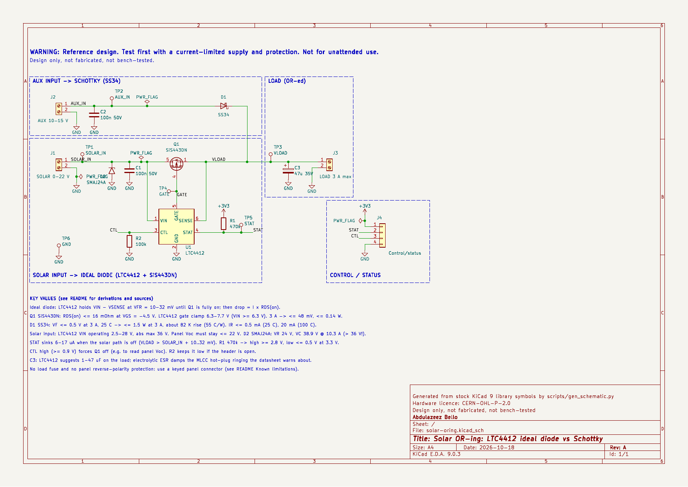

# Solar OR-ing: LTC4412 ideal diode vs a Schottky

Open-source KiCad reference design by **Abdulazeez Bello**, embedded systems engineer.

> **WARNING — Reference design. Test first with a current-limited supply and protection. Not for unattended use.**
> The AUX input is meant for a 12 V battery, which may be a lead-acid or Li-ion pack. Nothing here is certified or claims compliance with any safety standard.

**Status: Design only, not fabricated, not bench-tested.**

Schematic generated with AI assistance at my direction; I reviewed pin assignments against the datasheets.



| | |
|---|---|
| Schematic (PDF) | [`docs/solar-oring-schematic.pdf`](docs/solar-oring-schematic.pdf) |
| KiCad project (KiCad 9) | [`hardware/`](hardware/) |
| Bill of materials | [`docs/solar-oring-bom.csv`](docs/solar-oring-bom.csv) |
| ERC report | [`docs/erc.rpt`](docs/erc.rpt) |
| Drop and heat calculator | [`scripts/oring_calc.py`](scripts/oring_calc.py), output in [`docs/oring_calc_output.md`](docs/oring_calc_output.md) |

---

## 1. What it does

Two DC sources share one load, and whichever is higher supplies it, with no back-feed between them:

- **SOLAR (J1)**: a 12 V-class panel, Voc ≤ 22 V. It passes through an **ideal diode**, built from an LTC4412 controller driving a SiS443DN P-channel MOSFET.
- **AUX (J2)**: a 12 V battery or adapter, 10–15 V. It passes through a plain **SS34 Schottky diode**.
- **LOAD (J3)**: up to 3 A.

The two paths sit side by side on purpose. The board is a working OR-ing circuit, and it also lets you measure the difference between an ideal diode and a Schottky on the bench. A 4-pin header (J4) gives a microcontroller two signals:

- **STAT** tells it whether the solar path is conducting.
- **CTL** lets it switch the solar path off, for example to read the panel's open-circuit voltage.

```
SOLAR ─┬─ TVS ─┬─ [Q1 SiS443DN, D→S] ──┬── VLOAD ── C3 47µ ── LOAD
       │       └─ U1 LTC4412 VIN  SENSE─┘   ▲
       │              GATE → Q1             │
AUX ───┴──────────── D1 SS34 (A→K) ─────────┘
```

## 2. Requirements

| # | Requirement | How it is met |
|---|---|---|
| R1 | LTC4412-style ideal diode | U1 LTC4412 + Q1 SiS443DN, wired per datasheet Figure 1 (primary MOSFET on VIN, auxiliary diode into SENSE) |
| R2 | Compared against a Schottky | The AUX path uses an SS34. A comparison table (§4) is computed from datasheet limits |
| R3 | Drop and heat comparison table | §4, generated by `oring_calc.py` |
| R4 | Solar input survives a 22 V panel | LTC4412 operating range 2.5–28 V. TVS standoff 24 V. Q1 rated −40 V |
| R5 | No AirChain parts, nets or layout | Generic nets; no AirChain parts or layout reused |

## 3. Design calculations

Every datasheet value is listed with its source in §10. Values that are **not** from a datasheet are marked **[ASSUMPTION]**.

### 3.1 How the LTC4412 behaves (datasheet Rev B)

- **Forward operation.** While SOLAR_IN is above VLOAD, the LTC4412 holds VIN − VSENSE at **V_FR = 10–32 mV** (20 mV typical). It does this by modulating Q1's gate. Once the load current makes I × R_DS(on) larger than V_FR, the gate is fully driven and the drop becomes I × R_DS(on).
- **Turn-off.** When VLOAD rises **V_RTO = 10–32 mV** above SOLAR_IN, GATE is pulled up to SENSE, which turns Q1 off. At the same time STAT starts sinking 6–17 µA.
- **Supply.** The IC is powered from VIN when only the primary source is present, and from SENSE when the auxiliary source is present. That means it stays alive at night on the AUX supply and holds Q1 off.
- **Gate drive.** Drive is the smaller of VIN and the internal clamp **V_G(ON) = 6.3–7.7 V**.
- **Ratings.** VIN and SENSE operate from 2.5 V to 28 V. The absolute maximum is **−14 V to 36 V**.

### 3.2 Q1 (Vishay SiS443DN, doc 63253 rev C)

| Parameter | Datasheet | In this circuit |
|---|---|---|
| V_DS | −40 V | Worst case is at night with the panel at 0 V: V_DS = −V_LOAD ≈ −15 V. A reversed panel clamped by the TVS gives ≈ −16 V |
| V_GS | ±20 V | ≤ 7.7 V (the LTC4412 clamp) |
| R_DS(on) max | 16 mΩ at −4.5 V; 11.7 mΩ at −10 V | Gate drive is ≥ 6.3 V once SOLAR_IN ≥ 6.3 V, so ≤ 16 mΩ applies. Below 4.5 V of input, R_DS(on) is not specified |
| R_thJA | 81 °C/W steady-state max | Used for the ΔT figures |
| I_DSS | ≤ 1 µA at −40 V, 25 °C; ≤ 5 µA at 55 °C | Reverse leakage into the panel |

The orientation follows from the body diode. In a P-MOSFET the body diode runs from drain (anode) to source (cathode). The **drain goes to SOLAR_IN and the source to VLOAD**, so the body diode conducts in the forward direction, which matches the datasheet's statement that the load is "initially pulled up by the drain-source diode". It is reverse-biased whenever VLOAD is above SOLAR_IN. Datasheet Figure 1 does not label drain and source, so this orientation comes from the body-diode reasoning, not from a labelled drawing.

### 3.3 D1 (Vishay SS34, doc 88751, 23-Apr-2020)

- V_F ≤ **0.50 V at 3 A**, 25 °C. This is the only tabulated point; lower currents are shown only on a graph.
- I_R ≤ **0.5 mA** at 40 V and 25 °C, and ≤ **20 mA** at 100 °C.
- R_θJA 55 °C/W typical, on 14 × 14 mm copper pads.
- **Package catch.** The stock KiCad `Diode:SS34` symbol defaults to the `D_SMA` footprint, but the Vishay SS34 is an **SMC (DO-214AB)** part. The footprint has been overridden to `Diode_SMD:D_SMC`.

### 3.4 Input protection (D2, Littelfuse SMAJ24A)

- V_R = 24 V, above the 22 V panel Voc.
- V_BR = 26.7–29.5 V at 1 mA.
- I_R ≤ 1 µA.
- **V_C = 38.9 V at I_pp = 10.3 A** (400 W, 10/1000 µs).
- **The clamp voltage at full rated pulse current exceeds the LTC4412's 36 V absolute maximum.** The TVS handles small surges and ESD, but a full-energy surge can still overstress U1. A lower-voltage TVS would eat into the margin above Voc. See §8.
- Panel Voc rises in cold weather. 22 V is taken as the maximum at the coldest operating temperature **[ASSUMPTION: you must check this against your own panel's datasheet]**.

### 3.5 Capacitors

- **C1 = 100 nF at VIN.** The datasheet suggests 0.1–10 µF close to the device.
- **C2 = 100 nF**, local bypass on the AUX input.
- **C3 = 47 µF / 35 V aluminium electrolytic.** The datasheet suggests 1–47 µF of load capacitance and warns that MLCCs can ring at hot-plug. The electrolytic's ESR damps that ringing. 35 V is 1.6× the 22 V maximum. Its size (6.3 × 5.8 mm) comes from a distributor listing, not from the Panasonic datasheet **[not verified]**.

### 3.6 STAT and CTL

- **STAT.** An open-drain output that sinks 6–17 µA when the solar path is off, and leaks ≤ 1 µA when it is on.
  - With R1 = 470 kΩ to 3.3 V, the high level is ≥ 3.3 − 0.47 = **2.83 V**.
  - The low level is ≤ 3.3 − 470 k × 6 µA = **0.48 V**.
  - An ESP32-S3 GPIO reads these correctly: V_IH ≥ 0.75 × VDD = 2.475 V and V_IL ≤ 0.825 V, taken from the ESP32-S3 DC characteristics used in the ADC-scaler design.
  - **STAT low means the solar path is not supplying the load.**
- **CTL.** V_IH max is 0.9 V, so a 3.3 V GPIO drives it directly. R2 (100 kΩ) holds it low if the header is unconnected, and costs 33 µA while CTL is driven high. Driving CTL high turns Q1 off and makes STAT sink.

### 3.7 Switchover timing (estimate)

- **Datasheet figures**, both specified with a 1 nF gate load:
  - GATE turn-off time t_G(OFF) is 13–22 µs.
  - Turn-on time t_G(ON) is 110–175 µs.
- **Q1's gate load** is C_iss = 4.37 nF typical, and its total gate charge is about 41.5 nC at −4.5 V.
- **[ASSUMPTION]** Scaling those times linearly with gate capacitance gives roughly **60–100 µs to turn off** and about **0.5–0.8 ms to turn on**.
- **During turn-on**, the body diode carries the current: V_SD ≤ 1.2 V at 3 A, i.e. ≤ 3.6 W for under a millisecond.
- **During turn-off**, a brief reverse current from AUX into the panel is possible.
- **None of this is simulated (§9).**

## 4. Drop and heat comparison

All rows use datasheet worst-case limits at 25 °C. For the SS34, 0.5 V at 3 A is the only tabulated point. Because forward voltage rises with current, 0.5 V is an upper bound at every current up to 3 A, which is why those cells say "≤".

| Load | Ideal diode drop | Ideal diode heat | Ideal diode ΔT (81 °C/W) | SS34 drop | SS34 heat | SS34 ΔT (55 °C/W) | Loss at 12 V (ideal / Schottky) |
|---|---|---|---|---|---|---|---|
| 0.5 A | 32 mV | 16 mW | 1.3 K | ≤ 500 mV | ≤ 0.25 W | ≤ 14 K | 0.27 % / ≤ 4.2 % |
| 1.0 A | 32 mV | 32 mW | 2.6 K | ≤ 500 mV | ≤ 0.50 W | ≤ 28 K | 0.27 % / ≤ 4.2 % |
| 2.0 A | 32 mV | 64 mW | 5.2 K | ≤ 500 mV | ≤ 1.00 W | ≤ 55 K | 0.27 % / ≤ 4.2 % |
| 3.0 A | 48 mV | 144 mW | 11.7 K | ≤ 500 mV | ≤ 1.50 W | ≤ 82 K | 0.40 % / ≤ 4.2 % |

**At 3 A and 40 °C ambient [ASSUMPTION]:**

- **Ideal diode.** With R_DS(on) taken as 1.5× hot **[ASSUMPTION: the datasheet only gives a graph]**, the drop is 72 mV and the dissipation 216 mW, so T_J ≈ 57 °C.
- **SS34.** It dissipates 1.5 W, so T_J ≈ 122 °C against a 150 °C maximum. A Schottky's V_F falls as it heats, so this is pessimistic for the drop. Its leakage rises, though; see below.
- **Ideal-diode overhead.** The LTC4412 draws ≤ 26 µA (0.3 mW at 12 V).

**Reverse leakage (blocking direction):**

| Condition | Ideal diode (SiS443DN I_DSS + LTC4412 leakage) | SS34 I_R |
|---|---|---|
| 25 °C | ≤ 4 µA | ≤ 0.5 mA (at 40 V) |
| Hot | ≤ 8 µA (55 °C) | ≤ 20 mA (100 °C) |

**What the table shows.** At 3 A the Schottky wastes about 10× more power and runs about 70 K hotter. Its hot leakage, up to 20 mA, can also matter: a hot Schottky in a battery path slowly discharges that battery into whatever sits on the other side. Against that, the ideal diode costs an IC, a MOSFET and about 26 µA of quiescent current, and it needs at least ~4.5 V of input before its R_DS(on) is specified.

## 5. Decisions and trade-offs

| Decision | Why (datasheet basis) | What it costs |
|---|---|---|
| Ideal diode on the SOLAR path | Drop held at 10–32 mV, ≤ 48 mV at 3 A; panel energy is the scarce resource | U1 + Q1; 26 µA quiescent; no defined R_DS(on) below 4.5 V of input |
| Schottky on the AUX path | Simple and passive, and it is the comparison baseline; follows LTC4412 datasheet Figure 1 | ≤ 0.5 V and ≤ 1.5 W at 3 A; leakage up to 20 mA when hot |
| SiS443DN (−40 V, 16 mΩ at −4.5 V) | V_DS has margin over 15 V reverse; R_DS(on) is specified at the 4.5 V level the LTC4412 clamp exceeds | PowerPAK 1212-8 needs a drain copper pour for 81 °C/W; not hand-solder friendly |
| SS34 in SMC | 3 A, 40 V; V_F 0.5 V at 3 A | Library default footprint (SMA) was wrong for the Vishay part and had to be overridden |
| SMAJ24A TVS on SOLAR_IN | V_R 24 V sits above the 22 V Voc | V_C 38.9 V at full pulse current exceeds U1's 36 V absolute maximum |
| C3 47 µF electrolytic | Datasheet range 1–47 µF; ESR damps MLCC hot-plug ringing | Bulkier than an MLCC; limited life at high temperature |
| R1 470 kΩ STAT pull-up | 6–17 µA sink gives ≤ 0.48 V low, ≥ 2.83 V high | Slow edge (470 k × pin capacitance); fine for a status flag |
| CTL exposed with 100 k pull-down | Lets firmware isolate the panel; the internal 3.5 µA pull-down alone is weak | One more resistor; 33 µA while driven high |
| No load fuse, no reverse-panel protection | Kept out of scope to keep the comparison clean | See §8. The board is not protected against a reversed panel or a shorted load |

## 6. Bill of materials

Generated with `kicad-cli sch export bom` → [`docs/solar-oring-bom.csv`](docs/solar-oring-bom.csv).

| Ref | Value | Package | Manufacturer | MPN |
|---|---|---|---|---|
| U1 | LTC4412 | TSOT-23-6 | Analog Devices | LTC4412ES6#TRMPBF |
| Q1 | SiS443DN | PowerPAK 1212-8 | Vishay Siliconix | SiS443DN-T1-GE3 |
| D1 | SS34 | SMC (DO-214AB) | Vishay | SS34-E3/57T |
| D2 | SMAJ24A | SMA (DO-214AC) | Littelfuse | SMAJ24A |
| C1, C2 | 100 nF 50 V X7R | 0603 | Murata | GRM188R71H104KA93D |
| C3 | 47 µF 35 V | 6.3 × 5.8 mm SMD electrolytic | Panasonic | EEE-FK1V470P |
| R1 | 470 kΩ 1 % | 0603 | Yageo | RC0603FR-07470KL |
| R2 | 100 kΩ 1 % | 0603 | Yageo | RC0603FR-07100KL |
| J1, J2, J3 | 2-way screw terminal 5.08 mm | THT | Phoenix Contact | 1715721 |
| J4 | 1×4 header 2.54 mm | THT | generic | — |
| TP1–TP5 | Test point, red | THT | Keystone | 5000 |
| TP6 | Test point, black | THT | Keystone | 5001 |

J4 pinout: 1 = +3V3 (pull-up supply from your MCU), 2 = STAT, 3 = CTL, 4 = GND.

The MPN ordering suffixes follow each manufacturer's scheme. Confirm stock and lifecycle status at a distributor before ordering.

## 7. How to test it on the bench

**Equipment.** Two current-limited bench supplies. An electronic load, or power resistors (12 Ω / 15 W for 1 A at 12 V). A DMM. An oscilloscope. A thermocouple or thermal camera. A 3.3 V source for J4.

1. **Unpowered checks** (DMM diode test):
   - TP2 → TP3 (SS34): 0.15–0.35 V.
   - TP1 → TP3 (Q1 body diode): roughly 0.5–0.7 V.
   - TP3 → TP1: open.
   - TP3 → TP2: open.
2. **AUX only.** Set AUX to 12.0 V with a 200 mA limit, connect a 100 Ω load and put 3.3 V on J4-1. Expect:
   - VLOAD = 12 V minus the SS34 drop at 0.12 A (≤ 0.5 V).
   - STAT (TP5) low, ≤ 0.5 V.
   - GATE (TP4) at VLOAD, so Q1 is off.
   - Current into the SOLAR terminal measured with a µA meter to 0 V: no more than a few µA (≤ 4 µA from Q1 and U1, plus ≤ 1 µA of TVS leakage).
3. **SOLAR only.** Set the supply to 18.0 V, **current limit 0.5 A**, with a 100 Ω load. Expect:
   - TP1 − TP3 = 10–32 mV (the regulated V_FR).
   - STAT high (≥ 2.8 V).
   - VGS for Q1 (TP4 minus TP3) somewhere above its threshold; the loop sets it.
4. **Drop and heat** (raise the current limit step by step). At 0.5, 1, 2 and 3 A on each path in turn, measure:
   - **Solar path, TP1 − TP3:** ≤ 32 mV up to 2 A, ≤ 48 mV at 3 A (25 °C limits).
   - **AUX path, TP2 − TP3:** ≤ 0.5 V at 3 A.
   - **Case temperature after 10 minutes.** Expect Q1 roughly 12 K above ambient and D1 up to roughly 80 K above at 3 A. These ΔT figures depend on your copper area.

   Record all of it. This table is the article's main result.
5. **Switchover.** Run SOLAR at 18 V and AUX at 12 V with a 1 A load, then ramp SOLAR down. STAT should go low once VLOAD exceeds SOLAR_IN by 10–32 mV. Scope VLOAD during the handover; the droop should not exceed one diode drop.
6. **CTL.** With both sources on, drive J4-3 to 3.3 V. Q1 turns off, VLOAD falls to AUX − V_F and STAT goes low.
7. **Reverse blocking.** With AUX at 12 V and the SOLAR supply off but connected, measure the supply's back-current. Expect µA levels and no reverse conduction through Q1.

Never apply more than 22 V to J1, and keep the TVS in place.

## 8. Known limitations

- **TVS clamp above U1's absolute maximum.** At the full rated 10.3 A pulse, the SMAJ24A clamps at 38.9 V against U1's 36 V limit. Small surges are fine; a lightning-induced surge on long panel cables may not be. Options are a lower-V_C TVS (tighter Voc margin) or a series element ahead of U1. Neither is analysed here.
- **No reverse-panel protection.** A reversed panel forward-biases D2, which would then carry the panel's short-circuit current continuously. The SMAJ series is rated 3.3 W steady-state only on an infinite heat sink, so D2 may overheat or fail short. Use a keyed connector, for example MC4 at the panel.
- **No load fuse or current limit.** A shorted load is fed by both sources. Add a fuse or PTC per source in a real build.
- **Below ~4.5 V of solar input**, Q1's R_DS(on) is not specified (gate drive equals VIN), so at dawn and dusk the drop may exceed the table.
- **Hot R_DS(on) and SS34 V_F at low currents** come from graphs only. The table uses safe bounds.
- **Thermal figures assume the datasheet mounting conditions** (Q1: steady-state R_thJA; SS34: 14 × 14 mm pads). A real layout will differ.
- **This is not an MPPT charger.** The panel feeds the load directly, and its operating point is set by the load, not optimised.
- **Only the schematic exists.** There is no PCB layout.

## 9. Verification done (design stage only)

**ERC.** KiCad 9.0.3 `kicad-cli sch erc --severity-all`: **0 errors, 0 warnings** ([`docs/erc.rpt`](docs/erc.rpt)). The library-symbol check confirms every embedded symbol matches the stock KiCad 9 library.

**Netlist.** `scripts/verify_netlist.py` compares every net against the intended connectivity. It passes.

**Footprints.** All ten footprints exist in the KiCad 9 libraries.

**Pin-by-pin check:**

| Part | Datasheet pinning | KiCad symbol pin → net | Result |
|---|---|---|---|
| U1 LTC4412 (TSOT-23-6, Rev B) | 1 VIN, 2 GND, 3 CTL, 4 STAT, 5 GATE, 6 SENSE | 1 → SOLAR_IN, 2 → GND, 3 → CTL, 4 → STAT, 5 → GATE, 6 → VLOAD | Matches. KiCad `TSOT-23-6` pads 1–6 run counter-clockwise from pin 1 |
| Q1 SiS443DN (PowerPAK 1212-8, doc 63253) | 1–3 S, 4 G, 5–8 D (drain on the exposed pad) | Symbol 1, 2, 3 (S) → VLOAD; 4 (G) → GATE; 5 (D) → SOLAR_IN. Footprint pads 1–4 plus a merged pad 5 for drain | Matches. Drain on the input side, per the body-diode reasoning in §3.2. Bottom pad = drain is inferred from Vishay AN822 and the footprint, not stated in the datasheet text |
| D1 SS34 (Vishay, SMC) | Cathode band | Symbol 1 (K) → VLOAD, 2 (A) → AUX_IN. `D_SMC` pad 1 = cathode | Matches. Footprint overridden from SMA to SMC |
| D2 SMAJ24A (Littelfuse, SMA) | Cathode band (unidirectional) | Symbol pin 1 is on the bar (cathode) side → SOLAR_IN; pin 2 → GND. `D_SMA` pad 1 = cathode | Matches. The symbol names its pins A1/A2; the cathode was confirmed from the graphic |

**Simulation: not done.** ngspice has no LTC4412 model; Analog Devices distributes its model for LTspice, which was not available here. A behavioural stand-in would only restate the datasheet numbers already used in §4, so none was built. **Unverified as a result:** switchover timing (§3.7), loop stability of the 20 mV regulation with C3, and the droop at handover. Bench steps 5 and 6 cover these.

## 10. Sources

- Analog Devices, *LTC4412 Low Loss PowerPath Controller*, Rev B (02/15): [analog.com](https://www.analog.com/media/en/technical-documentation/data-sheets/4412fb.pdf)
- Vishay Siliconix, *SiS443DN*, doc 63253 Rev C (05-Aug-13): [vishay.com](https://www.vishay.com/docs/63253/sis443dn.pdf)
- Vishay, *SS32 thru SS36*, doc 88751 (23-Apr-2020): [vishay.com](https://www.vishay.com/docs/88751/ss32.pdf)
- Littelfuse, *SMAJ series* (rev 10/21/20): [PDF](https://4donline.ihs.com/images/VipMasterIC/IC/LFSI/LFSI-S-A0011271570/LFSI-S-A0011345017-1.pdf?hkey=6D3A4C79FDBF58556ACFDE234799DDF0)
- Yageo RC series spec sheet: [yageogroup.com](https://www.yageogroup.com/component-documentation/download/specsheet/RC0805FR-0712KL)
- Panasonic EEE-FK1V470P: **datasheet not read**; size and rating from the [RS listing](https://rsonline.cn/web/p/aluminium-capacitors/5370657)
- Murata GRM188R71H104KA93D: **datasheet not read**; ratings from the part number

## 11. Reproducing

The project was built with KiCad 9.0.3 (Ubuntu 25.10 package).

```sh
KICAD_CLI=kicad-cli SYMDIR=/usr/share/kicad/symbols sh scripts/build.sh   # schematic, ERC, netlist check, PDF, BOM
python3 scripts/oring_calc.py                                             # comparison tables
```

## 12. Status

**Design only, not fabricated, not bench-tested.**

Schematic generated with AI assistance at my direction; I reviewed pin assignments against the datasheets.

## 13. Licence

- Hardware files (`hardware/`, schematic PDF and PNG): **CERN-OHL-P-2.0**, see [`LICENSE-CERN-OHL-P-2.0.txt`](LICENSE-CERN-OHL-P-2.0.txt)
- Scripts (`scripts/`): **MIT**, see [`LICENSE-MIT.txt`](LICENSE-MIT.txt)
- Documentation follows the hardware licence.

© 2026 Abdulazeez Bello
